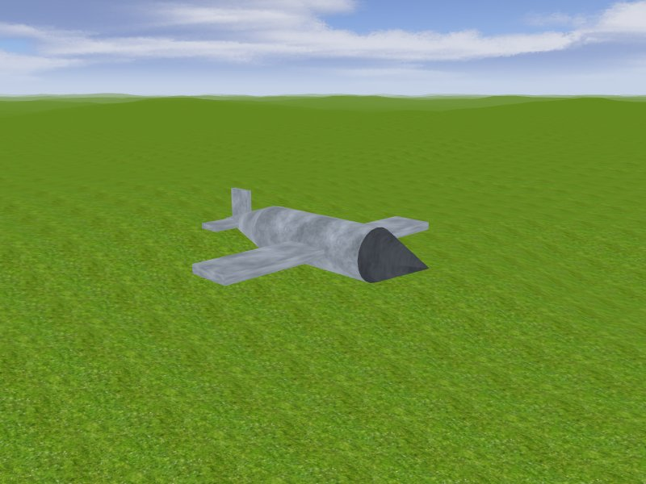
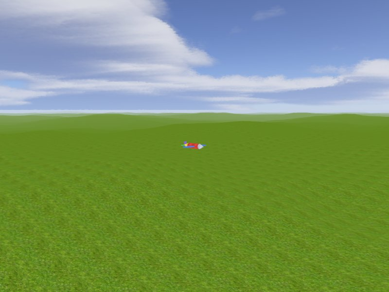
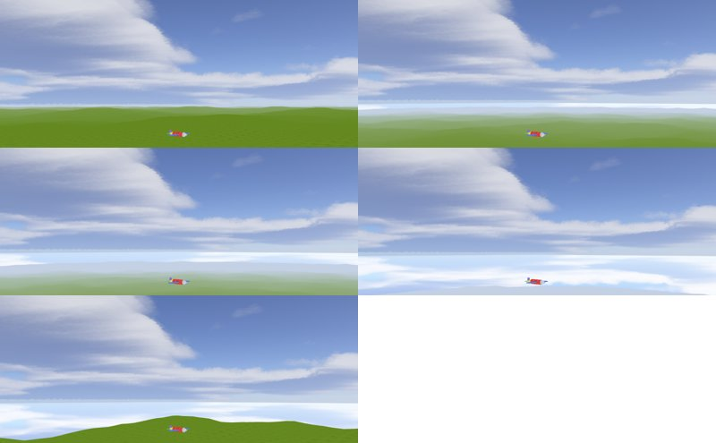

# Práctico 08 — Texturas y cielo: decisiones

Apunte de diseño del **Práctico 08**. Explica cómo se cargan las imágenes, cómo se crea una textura en la GPU y cómo se texturan el terreno y el avión. También cubre cómo se armó el cielo (cubemap y degradé) y cómo se resolvió el "problema de la altitud" con el suelo continuado. Para cada decisión se dice **por qué** se tomó. Sigue el formato de los apuntes anteriores.

Las dudas al leer la guía y las respuestas están en [`Practico08-Consultas.md`](Practico08-Consultas.md). Lo que queda para el Práctico 09, y por qué no se hizo ahora, está en [`Practico09-Pendientes.md`](Practico09-Pendientes.md).

---

## Objetivo

Mejorar la apariencia de la escena con **texturas**. Hasta acá cada objeto tenía un color plano (un valor por objeto, o por vértice interpolado). Con una textura, el color se decide **punto por punto** leyendo una imagen guardada en la memoria de la GPU. Hay que hacer cinco cosas:

1. que el terreno parezca **suelo** (pasto);
2. agregar un **cielo** de fondo;
3. **verificar** las coordenadas de textura de las primitivas, que existen desde el Práctico 03 pero nunca se usaron;
4. resolver la **banda** que aparece entre el terreno y el horizonte al subir;
5. como extra, darle una **textura al avión**.

**Punto de partida:** la escena del Práctico 07, que incluye el LOD (*geometry clipmaps*) y la niebla leve.

---

## Resumen de lo que se agregó

| Pieza | Qué es | Parte de la guía |
|---|---|---|
| `third_party/stb/stb_image.h` | decodificador de imágenes de un solo encabezado (v2.30, MIT / dominio público) | Punto de partida |
| `ResourceManager` (+`ImageData`) | `load_image` / `get_image` / `unload_image` | Parte 1 |
| `Texture.h/.cpp` (nuevo) | dueño único de una textura de OpenGL: 2D, cubemap y 1D | Parte 1 |
| `Shader` | `set_uniform` para `vec2` e `int` | — |
| `RenderItem` | `const Texture* textura` (no dueño) y `escala_uv` | Parte 3 |
| `Terrain` | coordenadas de textura en **coordenadas de mundo**, `set_textura`, depuración | Parte 2 y 5 |
| `Aircraft` | `set_textura` (chapa o imagen de prueba) y escala por pieza | Parte 3 y extra |
| `Skybox.h/.cpp` (nuevo) | el fondo: cubo + cubemap + degradé + suelo continuado | Partes 4, 5 y opcional |
| `terreno.vs/.fs` (nuevos) | morph del LOD + pasto + niebla | Parte 2 |
| `aeronave.vs/.fs` (nuevos) | piezas del avión: color, chapa o imagen de prueba | Parte 3 |
| `fondo.vs/.fs` (nuevos) | cielo (cubemap o degradé) + suelo continuado | Partes 4 y 5 |
| `solid.vs/.fs` | **obsoletos** (ya no se cargan; quedan como referencia del P07) | — |
| `assets/textures/` | pasto, cubemap, chapa y camuflaje del avión, imagen de prueba + `LICENCIAS.md` | — |
| `tools/generar_camuflaje.py` | genera el camuflaje del avión (tileable, con el detalle de la chapa) | extra |
| `tools/generar_imagen_prueba_uv.py` | genera la imagen de prueba asimétrica | Parte 3 |
| `tests/main_test_rm.cpp` | 6 pruebas nuevas de imágenes (sin OpenGL) | Parte 1 |

---

## Parte 1 — Leer imágenes y el módulo `Texture`

### Leer y decodificar: `ResourceManager` + stb_image

OpenGL no lee archivos: solo procesa bytes. Antes de crear una textura hay que **decodificar** el PNG o JPG a un arreglo de colores. Eso es C++ puro, y por eso va en `ResourceManager`, que ya era el único módulo que lee archivos. Se sigue el mismo patrón que con los shaders: un `struct` por tipo de recurso (`ImageData`), `load_image` / `get_image` y un mapa propio.

```cpp
struct ImageData {
    int width = 0, height = 0;
    int channels = 0;                    // canales del ARCHIVO (informativo)
    std::vector<unsigned char> pixels;   // SIEMPRE RGBA: 4 bytes por texel
};
```

| Decisión | Por qué |
|---|---|
| **Siempre RGBA** (`stbi_load(..., 4)`) | El código que sube la imagen a la GPU no depende de cuántos canales trae el archivo (`grass.png` tiene 3, la chapa en JPG también, el cielo 4). |
| `#define STB_IMAGE_IMPLEMENTATION` **solo** en `ResourceManager.cpp` | Ese define hace que el encabezado incluya el **código** de las funciones, no solo sus declaraciones. En dos `.cpp`, el linkeador vería las funciones dos veces (símbolos duplicados). |
| `STBI_ONLY_PNG` y `STBI_ONLY_JPEG` | Solo se compilan los decodificadores que usamos. |
| *Pragmas* que silencian advertencias alrededor del `#include` | Es código externo: con `-Wall -Wextra` daría advertencias que no vamos a corregir. El proyecto sigue compilando **sin advertencias**. |
| Se copia a un `std::vector` y se llama a `stbi_image_free` | `stbi_load` reserva con `malloc`. Copiado a un vector, la memoria la administra C++ y no hay que acordarse de liberarla. |

**Las cuatro decisiones que pide la guía:**

1. **¿`ResourceManager` libera la imagen después de crear la textura? → Sí, con `unload_image(key)`.** La GPU ya tiene su copia. El cubemap son 6 × 900 × 900 × 4 B ≈ **19 MB** de CPU que no se vuelven a usar. El costo es que, si se la vuelve a pedir, hay que releer el disco. Todo lo que se necesita de las imágenes (el color del horizonte y el sol del cielo) se calcula **antes** de liberarlas.
2. **¿Cuándo se invierte la imagen? → Al cargarla** (parámetro `flip_vertically`), y no en el shader.
   - Un archivo guarda primero la fila de **arriba**; OpenGL pone el `(0,0)` de una textura 2D **abajo** a la izquierda. Sin invertir, la textura sale dada vuelta.
   - Las caras de un cubemap **no** se invierten: su convención (heredada de RenderMan) tiene el origen arriba.
   - `stbi_set_flip_vertically_on_load` es un **estado global** de stb. Si quedara en 1 después del pasto, el cielo que se carga después saldría invertido. Por eso se fija **en cada carga**.
   - Se aplica **una sola** solución (cargar invertido). Si además se invirtiera `v` en el shader, se invertiría dos veces.
3. **¿Una clase o dos para 2D y cubemap? → Una sola, `Texture`**, como propone la guía. Recuerda su tipo (`TipoTextura`) y también sirve para la textura 1D del degradé. Las tres comparten las mismas reglas de dueño único y el mismo `bind`.
4. **¿Los parámetros de muestreo quedan fijos? → No: `set_muestreo()`** los cambia después de creada la textura. Eso permite mostrar **en vivo** la diferencia "con y sin mipmaps" (tecla `I`).

**Misma clave con otro archivo u otro flip:** se avisa por consola y gana la primera carga, igual que con los shaders. Para tener la misma imagen invertida y sin invertir se usan **dos claves**. El test lo verifica.

### Crear la textura: las cuatro etapas en DSA

`Texture` recibe el **mismo tratamiento que `Mesh`**: dueño único del identificador (el destructor lo libera, la copia está prohibida, mover traspasa la propiedad y el movido queda en 0) y `clear()` sin banderas. Ningún `glDeleteTextures` existe fuera de la clase.

```cpp
glCreateTextures(GL_TEXTURE_2D, 1, &id_);                      // 1. crear
glTextureStorage2D(id_, niveles, GL_RGBA8, w, h);              // 2. reservar (INMUTABLE)
glTextureSubImage2D(id_, 0, 0, 0, w, h,                        // 3. llenar el nivel 0...
                    GL_RGBA, GL_UNSIGNED_BYTE, pixels);
glGenerateTextureMipmap(id_);                                  //    ...y la pirámide
glTextureParameteri(id_, GL_TEXTURE_MIN_FILTER, ...);          // 4. parametrizar
```

- **Dos formatos distintos.**
  - `GL_RGBA8` (etapa 2) es **cómo se guarda** en la GPU.
  - `GL_RGBA` + `GL_UNSIGNED_BYTE` (etapa 3) describen **los bytes que manda la CPU**.

  Pueden no coincidir y OpenGL convierte. El cubemap aprovecha eso: llega en RGBA y se guarda en `GL_RGB8`.
- **Niveles de mipmap:** `⌊log₂(máx(w, h))⌋ + 1`. Da 9 para el pasto de 256, 10 para la imagen de prueba de 512 y 11 para la chapa de 1024.
- **Sin constantes de OpenGL en el encabezado.** Igual que `Mesh.h` no incluye glad, los filtros y los modos de repetición son enums propios (`Filtro`, `Repeticion`) que se traducen a `GL_*` en `Texture.cpp`.
- **Protección:** si una textura con un solo nivel pide un filtro `*_MIPMAP_*`, se usa `GL_LINEAR`. Si no, la textura quedaría "incompleta" y se leería **negra**.
- **Preparado para el Práctico 09:** `load_2d(..., srgb = true)` usa `GL_SRGB8_ALPHA8`, que es el camino "por hardware" de la corrección gamma. Por ahora no se usa.

### Unidades de textura y `layout(binding)`

Un shader puede leer varias texturas a la vez. La GPU tiene **unidades** numeradas:
- En C++, `Texture::bind(n)` (que es `glBindTextureUnit`) enchufa la textura en la unidad `n`.
- En el shader, `layout(binding = n) uniform sampler2D ...` lee esa unidad.

Con `binding` no hace falta setear el sampler desde C++. El valor del sampler es el **número de unidad**, no el identificador de la textura.

| Programa | Unidad 0 | Unidad 1 | Unidad 2 |
|---|---|---|---|
| terreno | pasto (o prueba o trampa) | — | — |
| aeronave | chapa (o prueba) | — | — |
| fondo | cubemap del cielo | pasto (el mismo de la malla) | degradé 1D |

---

## Parte 2 — El terreno con textura

### Coordenadas de textura en **coordenadas de mundo** (adaptación al LOD)

La guía propone `(u, v) = (j/N, i/N)`, una copia de la textura sobre toda la malla, y después multiplicarla por un factor de repetición (`uTeselas`). **Con el clipmap eso no sirve:**
- cada nivel tiene otro tamaño, así que el pasto cambiaría de escala **en cada anillo**;
- además, la textura "saltaría" cada vez que un nivel se corre.

**Decisión:** cada vértice guarda su **posición en el mundo** `(x, y)` en `tex_coords`, y el shader la divide por el tamaño de la tesela:

```glsl
vTexCoord = aTexCoords / uTamTesela;     // terreno.vs: de unidades de escena a "teselas"
```

Así la textura queda **pegada al mundo**, es igual en todos los niveles y no se mueve cuando la ventana salta. Además es la **misma cuenta** que hace el suelo continuado del fondo (Parte 5), y por eso no hay costura en el borde.

**Precisión de los floats.** Un `float` tiene unos 7 dígitos: si `(x, y)` creciera sin límite (vuelos largos), las `(u, v)` perderían decimales y el pasto se vería "en escalones". Por eso el origen de cada nivel se toma **módulo `Terrain::kPeriodoUV` = 5120 u**, calculado en `double`. Como el período es un múltiplo **entero** del tamaño de la tesela (5120 / 5 = 1024), restar un período corre la textura un número entero de copias y, con `GL_REPEAT`, se ve exactamente igual. Cada nivel usa un origen distinto, pero todos difieren en múltiplos enteros de teselas, así que coinciden.

### Tamaño de la tesela (dato que pide la guía)

| Dato | Valor |
|---|---|
| Tamaño de una tesela | **5 u = 50 m** (`kTamTesela` en `main.cpp`; la referencia de la guía es 40 teselas sobre 2 km) |
| Teselas sobre el nivel fino (3,2 km) | 64 |
| Teselas sobre el clipmap completo (51,2 km) | **1024** |
| Tamaño de un texel del pasto en el suelo | 50 m / 256 ≈ **0,2 m** |

Una "tesela" es una **baldosa**: una copia de la imagen apoyada sobre el suelo (ver `Practico08-Consultas.md`, pregunta 6).

### Muestreo

Es el que recomienda la guía para el terreno:
- `GL_LINEAR_MIPMAP_LINEAR` (trilineal) para la **reducción**;
- `GL_LINEAR` para la **ampliación**;
- `GL_REPEAT` en S y T.

Es el valor por omisión de `Muestreo`.

### Un programa propio para el terreno

Hasta el Práctico 07 el terreno y el avión compartían `solid.vs/.fs`. Desde ahora cada tipo de objeto tiene **su propio programa** (`terreno`, `aeronave`, `fondo`):
- la guía 08 ya propone `terreno.vs/.fs` y `background.*`;
- la guía 09 da por hecho que existen los tres;
- el terreno necesita el morph y la escala de la tesela, que el avión no usa.

`main` dibuja cada lista de `RenderItem` con su programa (`dibujar_items`).

**Detalle de los shaders:** la textura se lee **siempre** y recién después se elige entre textura y color plano. El filtrado con mipmaps compara las coordenadas de fragmentos vecinos, y eso no está definido si la lectura queda dentro de un `if` que unos fragmentos toman y otros no.

### La trampa de los mipmaps (probada a propósito)

La tecla `I` recorre tres modos:

| `I` | Qué se ve | Por qué |
|---|---|---|
| 0, con mipmaps | pasto parejo hasta el horizonte | trilineal: la GPU usa el nivel de la pirámide adecuado a cuánto se achicó la textura |
| 1, sin mipmaps (`GL_LINEAR`) | hacia el horizonte la textura **titila** y aparece moiré al mover la cámara | lejos, un fragmento abarca decenas de texels y promediar 4 vecinos no los representa |
| 2, **la trampa** | el terreno se ve **negro** salvo muy de cerca | se reservaron 9 niveles pero **no** se llamó a `glGenerateTextureMipmap`: los niveles 1..8 tienen contenido **indefinido** (en este driver, ceros) y OpenGL **no da ningún error** |


En este driver (Mesa) el resultado es negro. En otros puede ser ruido de colores. El síntoma para reconocerla en el futuro: **de cerca bien, de lejos un color que no está en la imagen**.

---

## Parte 3 — Las coordenadas de las primitivas (y la apariencia del avión)

### `RenderItem` lleva la textura (decisión)

El código de dibujo necesita saber **qué textura** usa cada pieza. Se agregó a `RenderItem` un **puntero no dueño**, `const Texture* textura` (`nullptr` = color plano), como propone la guía.
- Igual que `mesh`, apunta a algo que vive en otro lado: las texturas las **posee `main`**.
- El `RenderItem` se arma y se consume dentro del mismo cuadro, así que el puntero nunca queda colgando.

**Alternativas descartadas:**
- un **identificador** numérico: el dibujo tendría que buscarlo en una tabla;
- un **shader por tipo de pieza**: multiplica programas para un dato que es solo "qué imagen".

También se agregó `escala_uv`, que indica cuántas veces se repite la textura sobre la pieza.

### Imagen de prueba asimétrica (tecla `U`)

La guía pide verificar las `(u, v)` con una imagen **asimétrica en los dos ejes**. Un damero no sirve, porque invertido o espejado se ve igual. Se generó `prueba_uv.png` con un script **declarado** (`tools/generar_imagen_prueba_uv.py`). Tiene:
- una **"F"** arriba a la izquierda (no tiene simetría en ningún eje);
- un **"2"** abajo a la derecha;
- una **flecha "ARRIBA"** (hacia donde crece `v`);
- las esquinas **"(0,0)"** y **"(1,1)"**;
- una barra **roja** en `u = 0` y una **verde** en `v = 0`;
- una grilla de 8×8.

Con `U`, la imagen se aplica **tal cual** (color blanco × textura, una copia por cara) a todas las piezas del avión y también al terreno.


**Qué hay que ver:**

| Primitiva | Esperado | Por qué |
|---|---|---|
| Terreno | "F" y "2" **derechas**, sin espejar, repetidas cada 50 m | flip al cargar + `(u, v)` = posición en el mundo |
| Cubo (alas, estabilizador, deriva) | una imagen completa por cara, legible desde afuera | las `(u, v)` de cada cara van de (0,0) a (1,1) con `u × v` = normal exterior |
| Cilindro (fuselaje) | la imagen "enrollada": `u` da la vuelta y `v` va a lo largo | proyección **cilíndrica** (Práctico 03) |
| Cono (nariz, cola) | la imagen **estirada en forma radial**, desde el vértice hacia la base | proyección de **disco**: no es un error, es otra forma de asignar `(u, v)` |

**Costura del cilindro:** la última columna de vértices repite la posición de la primera con `u = 1` en vez de `u = 0`, y esos vértices están **duplicados a propósito**. Con un solo vértice de `u = 0`, el último gajo interpolaría `u` de casi 1 a 0 y mostraría la imagen entera comprimida y al revés. Con la barra roja (`u = 0`) se ve dónde cae la costura.

### La apariencia del avión (extra, tecla `T`)

**¿Es este el práctico para texturar el avión? Sí.** La Parte 3 ya agrega la textura al `RenderItem`, y el Práctico 09 pregunta qué hacer con "las texturas que se hayan agregado a las piezas en el Práctico 08".

**Primer intento (descartado): chapa sobre los colores del Práctico 04.** La chapa teñía el rojo, azul, amarillo y violeta de las piezas: el avión seguía pareciendo **de juguete**. El problema no era la textura sino **los colores**, que se eligieron en el Práctico 04 para distinguir las piezas, no para que parezca un avión.

**Solución: tres apariencias**, que se recorren con `T` (enum `AparienciaAvion` en `Aircraft.h`):

| `T` | Apariencia | Cómo se pinta | Para qué |
|---|---|---|---|
| 0 (inicial) | **Camuflaje** | la textura `camuflaje.png` **tal cual** (color blanco × textura) | un avión militar creíble |
| 1 | **Metal gris** | la chapa **tiñe** un gris medio; la nariz es más oscura, como un radomo | un jet de entrenamiento sin pintar |
| 2 | **Colores de las piezas** | los colores planos del Práctico 04, sin textura | distinguir las piezas (defensa del P04) |

Además, `U` fuerza la imagen de prueba (verificación de la Parte 3).




**La chapa:** [Metal Plates 014](https://ambientcg.com/view?id=MetalPlates014) de ambientCG, **CC0**, 1024×1024. Es una chapa **gris neutra** con rayones y remaches chicos. Se descartaron otras:
- las oxidadas o industriales: no son de un avión;
- las de color: al multiplicar cambiarían el color de la pieza;
- un aluminio casi blanco: casi no se notaba.

**El camuflaje** no se encontró como textura CC0 que se repitiera bien. Se **generó** con `tools/generar_camuflaje.py` (script declarado, reproducible):
- **Manchas:** ruido aleatorio suavizado con un filtro aplicado sobre la **FFT**. La FFT trata la imagen como **periódica**, así que el resultado se repite **sin costura** con `GL_REPEAT`.
- **Colores:** el ruido se corta por **umbrales** en cuatro tonos (verde oscuro, oliva, marrón y arena), con bordes netos como pintura.
- **Detalle de la chapa:** se multiplica por la luminancia de la chapa dividida por su media, que en promedio vale 1. El avión usa **una sola textura** y el shader no cambió.

**Cómo se aplica "sin complicaciones":** el shader de la aeronave hace siempre `color × textura`. Lo que cambia por apariencia es qué color manda `Aircraft`:
- **Camuflaje y prueba UV:** color **blanco**, así la textura se ve tal cual.
- **Metal gris:** el gris de cada pieza **dividido por el brillo medio de la chapa** (0,57, lo calcula `Texture` al cargar). Multiplicar sin compensar oscurecería la pieza un 43 %; con la división, en promedio conserva su gris y la textura solo suma variación. El gris es **medio** (0,56–0,61) y no claro: con la compensación, los texels claros se recortan a blanco y un gris claro se veía "lavado".

**Escala por pieza:** cada pieza guarda cuántas veces se repite cada textura (`escalas_uv_` para la chapa, una copia cada ~0,3 u; `escalas_camuflaje_` para el camuflaje, una copia cada ~0,8 u, para manchas grandes respecto del avión). En el **cilindro** la repetición alrededor (`u`) es **entera** (2 y 1), así la textura empalma en la costura. En los **conos** (proyección radial) el camuflaje usa un recorte de 0,25 de la imagen; si no, las manchas quedaban chicas.

El *normal map* de la chapa (`chapa_normal_gl.jpg`) quedó en `assets/` para el opcional de *normal mapping* del Práctico 09.

---

## Parte 4 — El cielo: el módulo `Skybox`



El fondo es la parte "skybox" de `Scene` en `Arquitectura-Proyecto.md`. `Skybox` es **dueño** de su cubo (`Mesh`), su cubemap y su degradé (`Texture`) y su programa (`Shader`). Lo único que **no** es suyo es la textura del suelo: es la del terreno, y le llega como puntero en `ParametrosFondo`. Así el fondo usa siempre la misma textura que la malla, también con la imagen de prueba o con la trampa.

### Cubemap

- **Reserva y llenado:** se reserva **como 2D** (`glTextureStorage2D`) y se llena **como 3D** (`glTextureSubImage3D`, cada cara es una capa), en el orden `+X −X +Y −Y +Z −Z` = `right, left, top, bottom, front, back`. Las notas de clase listaban "izquierda, derecha…", pero el orden de OpenGL pone +X (derecha) primero.
- **Formato:** `GL_RGB8`, porque el cielo no necesita alfa (6 × 900² × 3 ≈ 13,9 MiB).
- **Mipmaps:** **no**. Un texel del cielo casi siempre se **amplía**: una cara de 900 px cubre 90° y en pantalla 90° son más de 900 px. Por eso no hay reducción que filtrar.
- **`GL_CLAMP_TO_EDGE`** en S, T y R. Con `GL_REPEAT` el filtrado tomaría texels del borde opuesto de cada cara y se verían líneas en las aristas.
- **`glEnable(GL_TEXTURE_CUBE_MAP_SEAMLESS)`**: el filtrado lineal también mira la cara vecina, así no aparece una línea en las aristas.

### La ilusión: vista sin traslación

```cpp
const glm::mat4 vista_sin_traslacion = glm::mat4(glm::mat3(vista));
```

- `mat3` se queda con la rotación y `mat4` vuelve a agrandar la matriz con traslación cero.
- El cubo queda **siempre centrado en el ojo**: el observador nunca se acerca a sus caras, no hay paralaje y el cielo se percibe infinitamente lejos.
- Es equivalente a mover el cubo con el ojo: `R·T(−ojo)·T(ojo) = R`.

**En nuestro proyecto** (origen flotante), con la vista completa el cubo quedaría centrado en el **avión** y la cámara, a 2–40 u, quedaría **afuera** del cubo.

### Profundidad: método (b)

El fondo se dibuja **al último**. En `fondo.vs`, `gl_Position = pos.xyww`: con `z = w` la profundidad vale 1 (el plano lejano) para todo el cubo. Con `glDepthFunc(GL_LEQUAL)`:
- donde la escena no dibujó nada, el z-buffer quedó en 1 y `1 ≤ 1` pasa;
- donde hay terreno o avión, falla y la GPU ni ejecuta el shader del fondo (*early depth test*).

Se eligió (b) frente a (a) ("primero, sin escribir el z-buffer") por dos motivos:
1. **no pinta** píxeles que la escena tapa después, y el shader del fondo es el más caro (tres texturas + intersección);
2. el cubo **no puede quedar cortado** por el plano cercano.

Al terminar se vuelve a `GL_LESS`.

### Recorte de caras

El cubo de las primitivas se armó antihorario **visto desde afuera**. Desde adentro todas sus caras se ven con el giro invertido y el recorte de caras traseras las descartaría **todas**. Por eso `Skybox::draw` desactiva `GL_CULL_FACE` y lo reactiva al terminar. También fuerza `GL_FILL`, para que el cielo no salga en alambre con la tecla `F`.

### Escena Z-arriba vs. cubemap Y-arriba

El cubemap de OpenGL tiene "arriba" en +Y y nuestra escena en +Z. En `fondo.fs` la dirección se reacomoda:

```glsl
vec3 a_cubemap(vec3 d) { return vec3(d.x, d.z, -d.y); }   // rotación de -90° alrededor de X
```

Es una **rotación**, no un intercambio de ejes, así que **no espeja** la imagen. Se verificó en las capturas: el horizonte del cubemap queda horizontal y continuo entre caras.

### Datos que se calculan del cubemap (antes de liberarlo)

| Dato | Cómo | Valor | Para qué |
|---|---|---|---|
| **Color del horizonte** | promedio de la fila central (3 filas) de las 4 caras laterales | **(0,767; 0,818; 0,896)** | color de la **niebla** (lo pide así el Práctico 09, Parte 4) |
| Color del cenit | promedio del centro de la cara de arriba | un gris (el cenit está nublado) | informativo |
| **Dirección del sol pintado** | centro de los píxeles más brillantes **por encima** del horizonte (la mitad de abajo es un reflejo) | **(−0,757; −0,425; 0,497)**, elevación **≈ 30°** | el Práctico 09 pide que `uSolDir` coincida con el sol pintado |

---

## Opcional — Cielo degradé 1D (tecla `K`)


- **La textura:** una **textura 1D de 64 texels** generada por código, sin archivo. Va del color del horizonte (`s = 0`) al del cenit (`s = 1`).
- **Cómo se lee:** se indexa por la **elevación** de la dirección, `s = asin(d.z) / 90°`.
- **Cuánto ocupa:** 64 texels contra los ~14 MiB del cubemap.

**Decisiones:**
- **Horizonte = el mismo color del horizonte del cubemap.** Así la niebla coincide con el cielo en los dos modos.
- **Cenit = un azul de cielo despejado elegido a mano** (0,22; 0,42; 0,78). El promedio de la cara de arriba del cubemap daba un gris, porque ese cenit está cubierto de nubes, y el degradé quedaba "lavado".
- **Mezcla con `sqrt(s)`:** en un cielo real casi todo el cambio de color ocurre cerca del horizonte.
- **Por debajo del horizonte** el `clamp` deja `s = 0` (el color del horizonte). Con el suelo continuado activo, esa zona la cubre el suelo.

La desventaja que marca la guía es que el fondo queda **simple** (sin nubes ni sol). Las capas que lo enriquecen (sol, estrellas, ciclo de la hora) se dejaron para el **ciclo día/noche, opcional del Práctico 09** (ver `Practico09-Pendientes.md`).

---

## Parte 5 — El problema de la altitud y el suelo continuado

### El problema

El cielo acompaña al ojo, así que su horizonte pintado queda **siempre a la altura del ojo**. El terreno es **finito** y está quieto. Al subir `h`, su borde (a `L/2`) se ve `atan(h / (L/2))` **por debajo** del horizonte. En el medio queda una **banda** donde se ve la mitad de abajo del cubemap, que en este cielo es un **reflejo** del cielo, como agua.

### Medición (lo que la guía pide dejar escrito)

Para medir sin pilotear se agregaron dos teclas de depuración:
- `RePág`/`AvPág` bajan o suben el terreno de a 100 m;
- `1` deja **solo el nivel fino** del LOD, una ventana de 3,2 km como la del Práctico 07.

La consola informa la altura del ojo sobre el terreno y la banda **teórica**.

| Altura del ojo sobre el terreno | Banda teórica, clipmap (L = 51,2 km) | Observado, clipmap | Banda teórica, solo nivel fino (L = 3,2 km) | Observado, nivel fino |
|---|---|---|---|---|
| ~200 m (vuelo normal) | 0,44° | **no se nota** | 7,1° | **se ve** |
| ~700 m | 1,56° | **empieza a notarse** (franja fina) | 23,6° | grande |
| ~1200 m | 2,68° | se ve claramente | 36,8° | enorme |
| ~3200 m | 7,1° | banda ancha | 63,4° | — |



*De izquierda a derecha y de arriba abajo: clipmap a ~200 m, ~700 m, ~1200 m y ~3200 m (todos sin suelo continuado), y solo el nivel fino a ~200 m.*

**Conclusión:**
- **Con el LOD**, la banda empieza a notarse recién a unos **600–700 m** sobre el terreno (≈ 1,5°). Con la ventana del Práctico 07 se veía desde el vuelo normal.
- La niebla ayuda: el borde lejano ya tiene el color del horizonte. Aun así, el reflejo del cubemap se distingue.
- La curvatura de la Tierra no es la causa: el horizonte real baja 0,39° a 150 m. **La causa es que el terreno es finito.**

### La solución: continuar el suelo en el fondo


*Las dos capturas son con solo el nivel fino a ~1200 m: la banda de 37° desaparece.*

Cada píxel del fondo **por debajo del horizonte** (`d.z < 0`) traza un rayo `P(t) = ojo + t·d` contra un **plano horizontal infinito** a la altura media del terreno, que es la misma intersección rayo-plano del ray tracer:

```glsl
float t  = uAlturaOjo / max(-d.z, 1.0e-4);        // ojo.z + t·d.z = z_suelo
vec2  xy = uOjoUV + t * d.xy;                     // punto del suelo visto en este píxel
vec3 suelo = texture(uTexturaSuelo, xy / uTamTesela).rgb;   // MISMA regla que la malla
suelo = aplicar_niebla(suelo, t);                 // MISMA niebla que la malla
```

**Adaptaciones al proyecto:**
- **Z-arriba:** la guía usa `d.y` y el plano `xz`; acá son `d.z` y el plano `xy`.
- **Origen flotante:**
  - el shader necesita la posición **real** del ojo, que la vista sin traslación ya no tiene;
  - `main` la calcula como `pos_avion + ojo_rel`, donde `ojo_rel` es la 4.ª columna de `inverse(vista)`;
  - `uOjoUV` es esa posición **módulo `kPeriodoUV`**, igual que el origen de las `(u, v)` de la malla, así el pasto continúa sin salto;
  - `uAlturaOjo` es la altura del ojo **sobre** el plano.
- **Misma textura, escala, origen y niebla que la malla.** Si no, en el borde se vería el cambio.
- **Las tres texturas se leen siempre** y recién después se elige (por los mipmaps). `max(-d.z, 1e-4)` evita la división por cero en el horizonte. Ahí `t` crece sin límite y el mipmap promedia solo, así que de lejos queda el color medio del pasto, que la niebla funde con el horizonte.

**Limitaciones:**
- El plano continúa la **textura** pero no la **forma**: con relieve en el borde se vería una llanura detrás. Con nuestro clipmap ese borde está a 25,6 km y totalmente en la niebla, así que no se nota.
- En el horizonte queda una **línea** entre el suelo con niebla y el cielo, y al subir se ve una **franja grisácea** debajo de ella. Se cierra en el Práctico 09, que mezcla el cielo con la niebla en los primeros grados de elevación (ver "Niebla" abajo).

---

## Niebla: qué cambió en este práctico

La niebla sigue siendo la **lineal** de la mejora leve del Práctico 07 (de 3 km a 18 km). Lo único que cambió es su **color**: ahora es el **color del horizonte del cubemap** (antes era el `glClearColor`). Con un color fijo cualquiera aparecería una franja entre el terreno lejano (con niebla) y el cielo (sin niebla).

**La franja grisácea con una línea al subir (se deja para el Práctico 09).** Debajo de la línea no hay cielo: es suelo lejano con niebla al 100 %, pintado del color promedio del horizonte. El cielo justo arriba tiene el color del cubemap en esa dirección (nubes) y los dos colores se tocan sin mezclarse. La solución es **fundir el cielo con la niebla cerca del horizonte** (`1 − smoothstep(0, 0.1, elevación)`), que es la Parte 4 del Práctico 09. Se probó adelantarla, junto con correr la niebla a 5–25 km, y **se volvió atrás** para respetar la regla de `Practico09-Pendientes.md`: lo que el 09 pide como parte suya se hace en el 09. Ver `Practico08-Consultas.md`, pregunta 22.

La **misma función** de niebla está en `terreno.fs`, `aeronave.fs` y `fondo.fs` (el suelo continuado tiene que recibir exactamente la misma). Está repetida **a propósito** hasta el Práctico 09, cuya Parte 1 la pasa a un archivo GLSL común. Ver `Practico09-Pendientes.md`.

---

## Teclas (agregadas en este práctico)

| Tecla | Qué hace | Para verificar |
|---|---|---|
| `U` | imagen de prueba UV en el avión y el terreno | Parte 3: orientación de las `(u, v)` |
| `T` | apariencia del avión: camuflaje → metal gris → colores de las piezas | extra |
| `I` | filtrado del pasto: con mipmaps → sin mipmaps → **trampa** | Parte 2 |
| `K` | cielo: cubemap ↔ degradé 1D | Parte 4 y opcional |
| `G` | suelo continuado on/off | Parte 5 |
| `1` | solo el nivel fino del LOD (ventana como el P07) | Parte 5 |
| `RePág` / `AvPág` | sube o baja la altura sobre el terreno (100 m por pulsación; se puede mantener apretada) | Parte 5 |

Las de antes siguen igual: flechas, `Q`/`E` y `W`/`S` para el vuelo; `ESPACIO` pausa; `F` alambre; `L` colores por nivel; `M` morph; `N` niebla. Cada tecla nueva informa su estado por la consola.

---

## Cómo se sabe que está bien (lista de la guía)

Se verificó con capturas de la ventana (las de este apunte) y, donde se indica, por cómo está construido el código.

| Criterio de la guía | Resultado |
|---|---|
| La imagen asimétrica se ve **derecha** en el terreno y en las caras del cubo, sin invertir ni espejar | ✔ "F" y "2" legibles en el terreno y en las placas del avión (`U`) |
| Hacia el horizonte el terreno no muestra franjas ni parpadea | ✔ con mipmaps (`I` = 0); sin ellos titila (`I` = 1) |
| Al trasladar la cámara el fondo no se mueve, y al rotarla sí; no se distinguen las aristas del cubo | ✔ por construcción (vista sin traslación) + capturas: el horizonte del cubemap sale continuo entre caras (`CLAMP_TO_EDGE` + `CUBE_MAP_SEAMLESS`) |
| El fondo nunca tapa al terreno ni a la aeronave | ✔ método (b): solo pinta donde el z-buffer quedó en 1 |
| A ninguna altitud aparece la banda, y no se distingue dónde termina la malla | ✔ con `G` activo (probado a ~1200 m solo con el nivel fino: banda de 37° tapada) |
| Ningún objeto se ve negro ni de un color que no está en la imagen | ✔ salvo a propósito con la trampa (`I` = 2) |
| Están escritas la cantidad de teselas y la altitud de la banda | ✔ arriba: tesela de 50 m (1024 sobre el clipmap); banda desde ~700 m con LOD y desde el vuelo normal sin LOD |

**Pruebas automáticas:** `tests/main_test_rm.cpp` (sin OpenGL) verifica la carga RGBA, el caché, el **volteo** (la fila 0 con flip es la última sin flip), el aviso ante una clave con otro flip, `unload_image` y el error ante un archivo inexistente.

```bash
g++ -std=c++17 -Wall -Wextra -I./src -I./third_party/stb src/core/ResourceManager.cpp \
    tests/main_test_rm.cpp -o build/test_rm && ./build/test_rm
```

---

## Cómo probarlo

```bash
make clean && make && ./bin/ogl-app      # make clean: el Makefile no sigue los .h
```

1. **Consola:** `texturas : pasto 256x256 (9 niveles de mipmap), tesela 50 m ...` y `cielo : cubemap 900x900 x 6; horizonte (niebla) = ...; sol pintado en ...`.
2. **Mirar el horizonte:** bajá la cámara con el mouse (arrastrar con el botón izquierdo). Se ven el cielo con nubes y el pasto, que se funde en la niebla.
3. **`U`:** la imagen de prueba en el avión y el terreno.
   - En el terreno, las "F" se leen bien.
   - En el fuselaje (cilindro) la imagen está enrollada, con la barra roja en la costura.
   - En la nariz y la cola (conos) está estirada en forma radial.
4. **`T`:** camuflaje → metal gris → colores del Práctico 04.
5. **`I` tres veces, mirando lejos:** con mipmaps queda parejo; sin mipmaps titila al mover la cámara; con la trampa se pone negro.
6. **`K`:** cubemap ↔ degradé.
7. **Banda:**
   - `1` (solo nivel fino), `G` (sin suelo continuado) y `RePág` varias veces: aparece la banda, que es el reflejo del cielo debajo del horizonte.
   - `G` otra vez: desaparece.
   - `1` otra vez (clipmap completo): la banda casi no se ve hasta ~700 m.

---

## Arquitectura

- **Capa de datos:** `ImageData` vive en `ResourceManager` (C++ puro).
- **Capa de sistemas:** se suman `Texture` (recurso de GPU, como `Mesh`) y `Skybox` (la parte "skybox" de `Scene`).
- **`main`:** sigue sin poseer recursos de OpenGL directamente (no hay `glDelete*`). Es dueño de las texturas 2D a través de objetos `Texture`, igual que es dueño de los `Shader`.

Ver `Arquitectura-Proyecto.md`.
