# Práctico 09 — Iluminación y niebla: decisiones

Apunte de diseño del **Práctico 09**. Se va completando **parte por parte**: después de cada parte se prueba y recién ahí se sigue con la próxima. Para cada decisión se dice **por qué** se tomó. Sigue el formato de los apuntes anteriores.

Las dudas y sus respuestas están en [`Practico09-Consultas.md`](Practico09-Consultas.md). Lo que el Práctico 08 dejó preparado y la lista de lo que corresponde al 09 están en [`Practico09-Pendientes.md`](Practico09-Pendientes.md).

---

## Objetivo

Mejorar la apariencia de la escena con **iluminación** y **niebla**:

1. un sol que ilumine el terreno y la aeronave con el modelo de **Phong**;
2. una niebla **exponencial** que funda la lejanía con el horizonte del cielo;
3. la **corrección gamma**, para que las cuentas de la luz se hagan en escala lineal;
4. como objetivo secundario, **verificar las normales**: existen desde el Práctico 03 (primitivas) y el Práctico 07 (terreno), pero ningún shader las usó todavía.

**Punto de partida:** la escena del Práctico 08: terreno texturado con LOD, fondo con cubemap y suelo continuado, y la aeronave armada con primitivas.

---

## Estado

| Parte | Tema | Estado |
|---|---|---|
| 1 | La iluminación como código compartido entre shaders | ✔ hecha (19-nov) |
| 2 | El terreno iluminado por el sol | ✔ hecha (22-nov) |
| 3 | La aeronave iluminada (material, matriz normal) | ✔ hecha (23-nov) |
| 4 | Niebla exponencial (también en el avión y el cielo) | ✔ hecha (25-nov) |
| 5 | Corrección gamma (y reajuste de la luz y la niebla) | ✔ hecha (25-nov) |
| Opcional 1 | Halo del sol (y la bruma que se aclara hacia el sol) | ✔ hecho (26-nov) |
| Opcionales 2 y 3 | día/noche → curvatura de la Tierra | siguen |

La **presentación de avance** es el viernes 27 de noviembre. El objetivo es llegar con las Partes 1 a 5.

---

## Decisiones tomadas antes de implementar (19-nov)

Antes de escribir código se respondieron estas preguntas de diseño. Las de la Parte 1 se aplican abajo; las demás se aplican cuando se llegue a su parte.

| # | Pregunta | Decisión | Por qué |
|---|---|---|---|
| 1 | ¿Cómo se arma un shader con más de un archivo? | **Una lista de archivos por etapa**, escrita en `main` al cargar cada programa. | Se ve, en un solo lugar, qué código usa cada programa. Cada archivo viaja como una cadena aparte, y el error dice qué archivo falló. Se descartaron un archivo común fijo (queda escondido) y un `#include` casero (es un preprocesador que hay que escribir y la guía no lo pide). |
| 2 | ¿Quién escribe la línea `#version`? | **`Shader`, en todas las etapas.** Ningún archivo la tiene. | Tiene que ser la primera línea del texto completo. Con una sola regla no hay dos tipos de archivo. |
| 3 | ¿Dónde viven los parámetros de la luz y quién los envía? | **Un struct `Iluminacion`**, con una sola instancia en `main`. Se **envía en cada cuadro** a los tres programas. | `uOjo` cambia en cada cuadro de todas formas. Son pocos uniforms y no vale la pena llevar la cuenta de qué cambió. |
| 4 | ¿Qué pasa con la niebla en la Parte 1? | Pasa al código común con la firma de la guía, `aplicar_niebla(color, P)`, pero **sigue siendo lineal**. La exponencial entra en la Parte 4. | La Parte 1 queda como una reorganización pura. Se verifica con que **la imagen sale igual que en el 08**. |
| 5 | ¿Phong o Blinn-Phong? | **Phong** (vector R) por omisión, y **Blinn-Phong con una tecla** para comparar (`ns × 4`). | Phong es lo que propone la guía y lo que usa el trazador de rayos del TP10. |
| 6 | Material de la aeronave | `Material {kd, ks, ns}` **en el `RenderItem`**, en lugar del color. La textura **multiplica** a `kd`. `ks` y `ns` dependen de la **apariencia**. | Camuflaje mate, metal brillante, colores de plástico. |
| 7 | Material del terreno | **`ks = 0`** (también en el suelo continuado). | Con brillo especular el pasto se ve mojado o de plástico. |
| 8 | Matriz normal | La del avión se calcula **en la CPU, por pieza** (`mat3`). **El terreno no la usa.** | La matriz de modelo del terreno es solo una traslación, así que la matriz normal es la identidad. |
| 9 | Normales del terreno | Se hacen **las dos** correcciones: el **borde × 2** y la **normal del nivel grueso** mezclada con el mismo α del morph. | Con luz, las dos se notarían en los bordes de los anillos. *(Al implementarla, en el clipmap el borde se resolvió con una grilla con **margen**, que da diferencias centrales exactas; el × 2 quedó en `generar_malla_terreno`. Ver la Parte 2.)* |
| 10 | El sol | Por omisión, el **sol pintado** del cubemap (~30° de elevación). Color 0,7 y ambiente 0,3. Teclas para subir y bajar el sol y para volver al pintado. | La luz tiene que venir de donde se ve el sol. 0,7 + 0,3 = 1, así no hay zonas quemadas. *(Con la gamma pasaron a 0,9 y 0,1: decisión 18.)* |
| 11 | Corrección gamma | **En el shader** (`pow 2,2`), con un `uniform` y una tecla. | Prenderla y apagarla para comparar es trivial. Por hardware habría que volver a crear las texturas. |
| 12 | Visibilidad de la niebla | **V fija**, con `V ≤ ~10 km` porque `L/2 = 25,6 km`. Que dependa de la altitud **solo si** al subir el terreno se pierde demasiado pronto. | Es lo más simple, y se ajusta con la gamma activa. |
| 13 | Teclas | Se reutilizan las que ya hacen lo mismo: **N** sigue siendo niebla sí/no. Se agregan **B**, **V**, **X**, **C**, **O/P**, **H**, **J** y **R** (Blinn-Phong). | Ninguna tecla existente choca con las funciones nuevas. |
| 14 | Alcance | **Partes 1 a 5** primero. Después los opcionales, en orden: halo del sol, día/noche y curvatura de la Tierra. | El día/noche usaría el cubemap del profe oscurecido + estrellas + el degradé, **si no es muy complejo**; si no, lo que propone la guía. |
| 15 | Forma de trabajo | **Parte por parte**, probando cada una. Documentación en el mismo formato que el 08. | — |

### Decisiones agregadas al empezar la Parte 3 (23-nov)

Al revisar el avión antes de implementar aparecieron dos problemas que no estaban en la lista original. Cambian decisiones de prácticos anteriores, así que se preguntaron aparte.

| # | Pregunta | Decisión | Por qué |
|---|---|---|---|
| 16 | El ápice del cono es **un solo vértice** con normal axial (0, 1, 0) (decisión del P03). Con luz, la nariz y la cola se verían como una ojiva redondeada. ¿Qué se hace? | **Un ápice por gajo:** N vértices en la punta, cada uno con la normal lateral del medio de su gajo. La coordenada de textura no cambia. | Es la solución habitual. Con 1 anillo, el abanico del ápice es **todo** el lateral, y la normal interpolada se desviaba ~33° a media altura. Se descartaron dejarlo (la luz del cono queda mal) y subir los anillos (achica la zona afectada pero no la elimina). |
| 17 | Con el avión del P08, la tecla **X** (M en lugar de la matriz normal) no mostraría **ninguna** diferencia. ¿Qué se hace? | La nariz y la cola salen de **un mismo cono unitario** (radio 1, alto 1), estirado con `S(r, h, r)` en su matriz local. | Es el caso que propone la guía ("un cono estirado a lo largo de su eje"). La forma del avión no cambia y quedan 3 mallas en lugar de 4, como las placas, que ya compartían el cubo. Se descartaron dejarlo (X sin efecto visible) y una pieza de prueba aparte (algo que existe solo para la verificación). |

### Decisiones agregadas en la Parte 5 (25-nov)

La guía pide volver a ajustar la luz ambiente y la visibilidad **con la corrección gamma activa**. Se midieron varias opciones sobre el mismo cuadro (ver la Parte 5) y se eligió:

| # | Pregunta | Decisión | Por qué |
|---|---|---|---|
| 18 | ¿Qué luz ambiente con la gamma? (reemplaza los valores de la decisión 10) | **Ambiente 0,10 y sol 0,90.** | Con 0,3 la cara en sombra se ve al 58 % de la textura y el relieve se aplana; con 0,1, al 35 %, casi como el 30 % de antes. Siguen sumando 1. |
| 19 | ¿Qué visibilidad con la gamma? (ajusta la decisión 12) | **V = 10 km**, fija. | Con la mezcla en lineal la niebla se ve más espesa. 10 km es el máximo del clipmap (92,3 % en el borde) y deja el contraste más parecido a la Parte 4. |

### Decisiones del opcional "halo del sol" (26-nov)

Se eligieron todas las recomendadas.

| # | Pregunta | Decisión | Por qué |
|---|---|---|---|
| 20 | ¿Qué forma tiene el halo? | **Disco + resplandor** alrededor de la dirección de la luz. | Es lo que se ve en un cielo real con algo de bruma; sobre el degradé se reconoce como el sol. Solo resplandor parece una luz difusa; solo disco, artificial. |
| 21 | ¿De qué tamaño el disco? | Primero **el real, 0,53°** (~7 px con la cámara de 45° en 600 px). Al verlo se veía **muy chico** y se agrandó a **2°** (~25 px), la otra opción que se había planteado. | El sol que percibimos parece más grande que su tamaño geométrico porque encandila; la pantalla no puede reproducir ese brillo, así que, como en los simuladores y los juegos, se dibuja más grande (consulta 22). |
| 22 | ¿De qué color e intensidad? | **Proporcional a `uSolColor`.** | El halo es la misma luz que ilumina la escena: si el sol cambia de color o se apaga (día/noche), lo sigue solo. |
| 23 | ¿Qué pasa cerca del horizonte? | El halo del cielo **se funde con la niebla** como el resto del cielo, **y la bruma se aclara hacia el sol** (en los tres programas). | Sin costura con el sol bajo (el cielo y el suelo usan la misma función), y el sol bajo brilla a través de la bruma. Es la misma física que el halo: la dispersión hacia adelante. |
| 24 | ¿Tecla? | **`Y` con tres modos:** completo / solo el halo del cielo / sin halo. | Como `B` y `J`: permite ver qué aporta cada parte. |

---

## Resumen de lo que se agregó (Parte 1)

| Pieza | Qué es |
|---|---|
| `assets/shaders/iluminacion.glsl` (nuevo) | Código GLSL **común**: uniforms de la escena (sol, ojo, niebla), `struct Material`, `iluminar()` (Phong) y `aplicar_niebla()`. |
| `src/core/ShaderSource.h` (nuevo) | El fuente de un programa en datos planos: **una lista de archivos por etapa** (`ShaderStageSource`: rutas y textos). Lo llena `ResourceManager` y lo compila `Shader`. |
| `src/core/Iluminacion.h/.cpp` (nuevo) | El struct `Iluminacion` (el **único lugar** de la CPU para la luz y la niebla) y el ayudante `buscar_uniforms_iluminacion` / `enviar_iluminacion`. |
| `ResourceManager` | `load_shader_source(key, {vs...}, {fs...})`: listas de archivos. Cada archivo queda como un texto aparte, terminado en `\n`. |
| `Shader` | `compile_from_source(const ShaderSource&)`: arma `#version` + `#line 1 N` + cada archivo. Si falla, dice qué archivo es cada número. `loc(nombre, false)` busca sin aviso. Compila el geometry shader si hay. |
| `terreno.*`, `aeronave.*`, `fondo.fs` | Sin la niebla repetida. Los vertex shaders mandan `vPosMundo` en lugar de `vDistancia`. |
| Todos los `.vs` / `.fs` | Sin la línea `#version`, que pasó a ser un comentario que explica dónde se agrega. |
| `Skybox` | `ParametrosFondo` lleva `const Iluminacion*` y el ojo, en lugar de los tres datos de niebla. |
| `main.cpp` | Carga con listas, la instancia `luz` y su envío a los tres programas. Un shader roto ya **no hace caer** el programa. |
| `tests/main_test_rm.cpp` | Adaptado a las listas, con pruebas nuevas: varios archivos, orden distinto con la misma clave, lista vacía. |

---

## Parte 1 — La iluminación como código compartido

### El problema

El terreno, el avión y el fondo (que pinta el suelo continuado) se dibujan con **tres programas distintos**. Los tres tienen que usar **el mismo sol y la misma niebla**: si uno usara otros valores, se vería una costura, por ejemplo donde la malla del terreno se encuentra con el suelo continuado. En el Práctico 08 la niebla estaba **repetida** en `terreno.fs`, `aeronave.fs` y `fondo.fs`, y era la única duplicación del proyecto (a propósito, hasta el 09).

### Cómo se arma un shader con varios archivos (decisión 1)

GLSL no tiene `#include`, pero `glShaderSource(shader, cantidad, cadenas, largos)` recibe un **arreglo** de cadenas y las compila como si fueran un único texto, una a continuación de la otra. Cada programa se carga con una lista de archivos por etapa:

```cpp
const std::string kComun = "shaders/iluminacion.glsl";
resources.load_shader_source("terreno", {"shaders/terreno.vs"}, {kComun, "shaders/terreno.fs"});
```

Y esto es lo que compila la GPU para el fragment shader del terreno:

```
cadena 0:  #version 460 core                  <- la agrega Shader
cadena 1:  #line 1 1   + iluminacion.glsl     (uniforms, Material, iluminar, aplicar_niebla)
cadena 2:  #line 1 2   + terreno.fs           (el código propio: ya puede usar lo de arriba)
```

El código común va **antes** que el propio, así que cuando empieza `terreno.fs` ya existen los uniforms, el `struct Material` y las funciones. Los vertex shaders siguen siendo de un solo archivo, pero se arman igual: `#version` + el archivo.

- **El `ResourceManager` no concatena:** guarda un texto por archivo (`ShaderStageSource`) y la que los une es la GPU. Así cada archivo sigue siendo una cadena aparte y el error puede decir cuál falló (ver abajo).
- **Se reemplazó la firma** en lugar de agregar una sobrecarga. Hay un solo camino; un programa de un solo archivo se escribe con listas de un elemento.
- **Cada texto termina en `\n`.** `glShaderSource` pega las cadenas tal cual: si un archivo no terminara en salto de línea, su última línea quedaría pegada a la primera del siguiente.
- **El struct `ShaderSource` pasó a su propio encabezado**, `ShaderSource.h`. Es la misma idea que `MeshData` entre `Primitives` y `Mesh`: un struct de solo datos en el medio, para que ninguno de los dos módulos dependa del otro.

### La línea `#version` la agrega `Shader` (decisión 2)

`#version` tiene que ser la **primera** línea del texto completo. Si `iluminacion.glsl` + `terreno.fs` la tuvieran, quedaría en el medio y no compilaría. Por eso **ningún archivo de `assets/shaders/` la tiene**, ni siquiera los vertex shaders, y `Shader` la antepone a todas las etapas. Una sola regla: no hay que acordarse qué archivo la lleva y cuál no. Si más adelante un vertex shader necesita código común (por ejemplo la curvatura de la Tierra en `terreno.vs`), no hay que cambiar nada.

En cada archivo, la línea `#version` se reemplazó por un comentario: `// Sin #version: desde el Práctico 09 la agrega la clase Shader…`.

### El error dice qué archivo falló (`#line`)

Con varias cadenas, ¿cómo se sabe en qué archivo está un error? El driver informa cada error como `cadena:línea(columna)`. Cada archivo arranca con la directiva `#line 1 N`, que quiere decir "la línea que sigue es la 1 del archivo número N". Así la línea informada es la **del archivo**, la misma que muestra el editor, y no la contada desde el principio del texto completo. Al fallar, `Shader` agrega qué archivo es cada número. Prueba hecha a propósito, con un error en `terreno.fs`:

```
[Shader] compilación del fragment shader fallida:
2:45(23): error: `uTexturaMal' undeclared
   (el primer número de cada error es el ARCHIVO: 0 = la línea #version que agrega Shader,
    1 = shaders/iluminacion.glsl, 2 = shaders/terreno.fs)
```

`2:45` es el archivo 2 (`terreno.fs`), línea 45: es exactamente donde estaba el error. Con un error en el código común salió `1:94`, línea 94 de `iluminacion.glsl`, también exacta.

### Dónde viven los parámetros de la luz: el struct `Iluminacion` (decisión 3)

La guía pide que los parámetros de la luz y de la niebla se definan **en un único lugar del lado de la CPU** y que desde ahí se envíen a todos los programas.

- **Un struct de solo datos**, `Iluminacion` (`src/core/Iluminacion.h`): dirección y color del sol, luz ambiente, y color, inicio y fin de la niebla. Es la "cara CPU" de `iluminacion.glsl`, con los mismos datos.
  - Como `FlightData` o `CameraData`, no pertenece a ningún módulo de dibujo: el terreno, el avión y el fondo **lo leen**, ninguno es su dueño.
  - **Una sola instancia**, `luz`, en `main`.
- **Quién y cuándo:** `main` lo envía **en cada cuadro** a los tres programas.
  - Terreno y aeronave: directamente, con `enviar_iluminacion`.
  - Fondo: el `Skybox` es dueño de su programa, así que lo recibe por `ParametrosFondo` y llama al mismo ayudante.
  - Se envía en cada cuadro porque `uOjo` cambia en todos los cuadros y el sol y la niebla cambian con teclas. Llevar la cuenta de "qué cambió" no ahorra nada.
- **Las ubicaciones se buscan una vez por programa** (`UniformsIluminacion`). Con `glProgramUniform*`, cada programa tiene **sus propios** uniforms aunque se llamen igual (lo advierte la guía).
- **Búsqueda sin aviso, con un informe.**
  - El compilador de GLSL **elimina los uniforms que no se usan**, y para esos `glGetUniformLocation` devuelve −1. En la Parte 1 nadie llama todavía a `iluminar()`, así que los del sol no existen en ningún programa. Que falten está previsto.
  - `Shader::loc` avisa cuando un uniform falta. Para estos se busca con `loc(nombre, false)`, sin aviso.
  - Para no perder de vista un nombre mal escrito, al arrancar se informa por consola cuántos usa cada programa:

```
[luz]    terreno: usa 4 de 7 uniforms de la escena (no usa: uSolDir, uSolColor, uAmbiente)
[luz]    aeronave: usa 4 de 7 uniforms de la escena (no usa: uSolDir, uSolColor, uAmbiente)
[luz]    fondo: usa 3 de 7 uniforms de la escena (no usa: uSolDir, uSolColor, uAmbiente, uOjo)
```

**¿Por qué el fondo no usa `uOjo`?** El fondo calcula el punto del suelo continuado como `P = uOjo + t·d`, y la niebla mide `length(P - uOjo)`. El compilador simplifica `(uOjo + t·d) − uOjo = t·d`, y `uOjo` deja de hacer falta: es la misma distancia `t` que usaba el Práctico 08. No es un error. En la Parte 2 el suelo continuado se ilumina y el informe va a cambiar.

**El ojo, en el mismo sistema que las posiciones.** "Mundo" en este proyecto es el sistema con **origen flotante**: el avión en el origen (Práctico 07). Los vertex shaders dejan `vPosMundo = uModel · posición`, que es relativa al avión. Por eso el ojo que se envía es `ojo_rel` (relativo al avión) y no `ojo_mundo`. Si se mezclaran los sistemas, no habría error, pero la distancia de la niebla saldría mal; con la luz, el síntoma sería que la luz se mueve con la cámara.

### La niebla se mudó sin cambiar (decisión 4)

- **Firma de la guía:** `aplicar_niebla(color, P)`, con `P` en mundo, igual que la usará la Parte 4. La fórmula sigue siendo la **lineal** del 08 (`uNieblaInicio` = 3 km, `uNieblaFin` = 18 km); la exponencial entra en la Parte 4.
- **De dónde sale la distancia:** antes la calculaba el vertex shader en el sistema de la cámara (`vDistancia = |posVista|`); ahora es `|P − uOjo|` en el fragment shader. Es **la misma distancia**, porque la vista es una transformación rígida y no cambia distancias.
  - La única diferencia es menor: antes se interpolaba la distancia entre los vértices y ahora se interpola la posición y se mide en cada fragmento, que es más exacto.
- **Suelo continuado:** usa el punto `P = uOjo + t·d`. Recibe **exactamente** la misma función que la malla.
- **Tecla N:** sigue funcionando igual (`uNieblaFin ≤ 0` = sin niebla).

### Qué tiene `iluminacion.glsl` ya en la Parte 1

Además de la niebla, el archivo ya tiene lo que la guía muestra para la Parte 1:
- los uniforms del sol (`uSolDir`, `uSolColor`, `uAmbiente`) y del ojo (`uOjo`);
- el `struct Material {kd, ks, ns}`;
- la función `iluminar(P, N, m)`: Phong con una luz direccional.

Nadie la llama todavía: el terreno empieza a usarla en la Parte 2 y el avión en la Parte 3. La dirección del sol ya se envía: es la del **sol pintado** en el cubemap (`Skybox::direccion_sol()`, ≈ 30° de elevación).

### De paso: un shader roto hacía caer el programa

Al probar los mensajes de error apareció un problema que venía del Práctico 08: si un programa no compilaba, el programa terminaba con **violación de segmento**.

- **Causa:** `main` cerraba la ventana (y con ella el **contexto de OpenGL**) y hacía `return` desde adentro del bloque donde viven los `Shader`. Al salir del bloque, sus destructores llamaban a `glDeleteProgram` **sin contexto**.
- **Arreglo:** si un programa no compila, se **lanza una excepción** (como ya hacía `Skybox::init`). Al salir del bloque se destruyen primero los `Shader`, con el contexto vivo, y recién en el `catch` se cierra la ventana.
- **Resultado:** ahora sale limpio, con código 1 y el mensaje `Error: un programa de shaders quedó vacío…`.

### Verificación

La Parte 1 es una **reorganización**: no tiene que cambiar nada en pantalla. Se comparó la vista inicial del Práctico 08 con la de la Parte 1, desde la misma cámara y a los 4 s de arrancar:

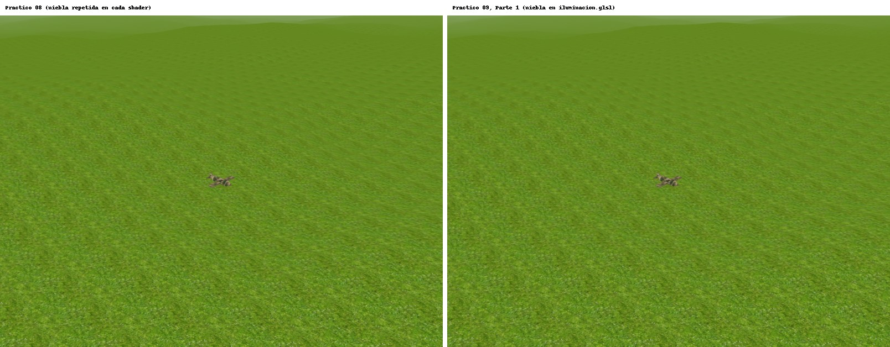

- **Color medio de toda la imagen:** (101,6; 137,6; 33,8) en las dos.
- **Color medio de la franja de arriba**, que es donde se ve la niebla: (108,4; 142,9; 48,7) en las dos.
- **Diferencia píxel a píxel:** unos 5/255, que viene del movimiento. El avión avanza ~1,5 m cada 10 ms y las dos capturas no se tomaron exactamente en el mismo instante, así que el pasto queda corrido unos píxeles. No es una diferencia de color.

Además:
- `make clean && make` compila sin advertencias (`-Wall -Wextra`).
- El test del `ResourceManager` pasa completo, incluidas las pruebas nuevas.
- Los errores de compilación informan el archivo y la línea correctos.

---

## Cómo probarlo (Parte 1)

```bash
make clean && make && ./bin/ogl-app
```

1. **La consola** muestra las tres líneas `[luz]` con los uniforms que usa cada programa (ver arriba).
2. **La imagen** tiene que ser igual a la del Práctico 08. Todas las teclas del 08 siguen funcionando:
   - **N:** con niebla, el borde del terreno se funde con el cielo; sin niebla, se ve.
   - **G:** con y sin suelo continuado, y no se ve costura entre la malla y el suelo.
   - **K:** el cielo cambia entre el cubemap y el degradé, y la niebla toma el color de cada uno.
3. **El mensaje de error** (opcional). Cambiar en `assets/shaders/terreno.fs` el nombre `uTextura` por otro inexistente. **No hace falta recompilar**, porque los shaders se leen al arrancar. Correr el programa: tiene que informar `2:<línea>` y salir limpio. Después volver el nombre a como estaba.

---

## Parte 2 — El terreno iluminado por el sol

### Resumen de lo que se agregó (Parte 2)

| Pieza | Qué cambió |
|---|---|
| `iluminacion.glsl` | `iluminar_suelo(P, N, kd)`: el **material del suelo** escrito una sola vez, para la malla y el suelo continuado. Uniform `uModoSuelo` (tecla `B`). Comentarios de las tres componentes de Phong. |
| `terreno.vs` | Manda la normal **en mundo** (`vNormalMundo`) y la **mezcla con la del nivel grueso** usando el mismo α del morph. Atributo nuevo `aNormalGruesa` (location 4). |
| `terreno.fs` | `kd` = la textura (o el color plano de la tecla `L`); luz con `iluminar_suelo`; niebla **después** de la luz. |
| `fondo.fs` | El suelo continuado se ilumina con la misma función, con la normal del plano **(0, 0, 1)**. |
| `Terrain.cpp` | Grilla de alturas con **margen** de 2 nodos: diferencias centrales en todos los vértices, también en el borde. Calcula la **normal del nivel grueso** de cada vértice. |
| `Terrain.h` | `generar_malla_terreno`: corrección del **borde × 2**. |
| `MeshData.h`, `Mesh.cpp` | `Vertex::normal_gruesa` y el atributo 4 del VAO. |
| `Iluminacion.h/.cpp` | Campo `modo_suelo`; `sol_con_elevacion()` (misma orientación del sol, otra elevación); el informe `[luz]` cuenta los uniforms solo. |
| `main.cpp` | Teclas **B**, **O/P**, **H**. El sol y el modo de `B` se asignan en el bucle (un solo lugar). |
| `tests/main_test_normales.cpp` (nuevo) | Prueba por cálculo de las normales de `generar_malla_terreno`. |

### La luz del sol (decisión 10)

- **Luz direccional.** El sol está tan lejos que sus rayos llegan **paralelos**: la dirección `L` es la misma en toda la escena (la `w = 0` de las filminas). Por eso es un `uniform` (`uSolDir`) y no se calcula por fragmento.
- **Coincide con el sol pintado.** Por omisión, `uSolDir` es la dirección del sol del cubemap, (−0,757; −0,425; 0,497), a **29,8°** de elevación (la calculó el `Skybox` en el 08). La luz viene de donde se ve el sol.
- **Color 0,7 y ambiente 0,3.** Suman 1: una cara que mira de frente al sol llega justo a `kd` y no se quema en blanco. Del lado opuesto al sol queda solo el ambiente (0,3·`kd`), que evita que las laderas en sombra queden negras.
- **Teclas O/P/H.** `O` y `P` bajan y suben el sol de a **5°**, entre 0° y 90°, **sin cambiar la orientación horizontal** (el acimut del sol pintado): `sol_con_elevacion()` arma la dirección en coordenadas esféricas con Z arriba. `H` lo vuelve al pintado. El sol **pintado** no se mueve (es una imagen): con `O`/`P` la luz deja de coincidir con él, a propósito, para comparar un sol alto con uno bajo. No se deja bajar del horizonte: Phong no tiene sombras y el sol iluminaría desde abajo (eso es tema del día/noche opcional).
- **Un solo lugar.** `luz.sol_dir` y `luz.modo_suelo` se asignan **en el bucle**, igual que el color y el fin de la niebla: lo que cambia con teclas se escribe en un solo lugar (es la misma regla de la consulta sobre las líneas repetidas de `niebla_color`).

### Los cambios en los shaders del terreno

- **Posición y normal en mundo.** El vertex shader ya mandaba `vPosMundo` desde la Parte 1. Ahora manda también `vNormalMundo`.
- **Sin matriz normal (decisión 8).** La guía dice que la normal se transforma con la matriz normal, `transpose(inverse(mat3(M)))`. Pero el modelo de cada nivel del terreno es **solo una traslación** (esquina − avión), y una normal es una **dirección**: las traslaciones no la afectan. La parte 3×3 de `M` es la identidad y su matriz normal también, así que la normal local **ya es** la normal en mundo. Queda comentado en `terreno.vs`. El avión sí la va a necesitar (Parte 3).
- **Hay que volver a normalizar.** La GPU interpola la normal entre los tres vértices y el promedio de vectores unitarios es **más corto** que 1. Como `N·L` supone largo 1, sin normalizar el centro de cada triángulo quedaría más oscuro. `terreno.fs` hace `N = normalize(vNormalMundo)`.
- **Sombreado de Phong.** La luz se calcula **por fragmento**, con la normal interpolada (sombreado de Phong). No hay que confundirlo con el **modelo** de Phong, que es la fórmula de `iluminar()`.
- **La niebla, después.** `color = iluminar_suelo(...)` y recién después `aplicar_niebla(color, P)`: la niebla es el aire entre el punto y el ojo y no depende del sol.

### El material del suelo (decisión 7)

La guía pide **dejar escrito** cuál es el material del terreno y por qué:

| Coeficiente | Valor | Por qué |
|---|---|---|
| `kd` (difuso) | **la textura del pasto** | Es el color propio de cada punto; la luz solo lo aclara u oscurece. En el P08 era el color final. |
| `ka` (ambiente) | **= `kd`** | Lo habitual: la luz ambiente tiñe el mismo color. `iluminar()` usa `uAmbiente · kd`. |
| `ks` (especular) | **0** | El pasto es **mate**. Con `ks > 0` toda la superficie brilla de la misma forma y, mirando hacia el sol, el pasto se ve mojado o de plástico. |
| `ns` (exponente) | 1 (sin efecto) | Con `ks = 0` el término especular es cero y `ns` no importa. |

**Dónde está escrito.** En `iluminacion.glsl`, en la función `iluminar_suelo(P, N, kd)`, y no en `terreno.fs` como en el fragmento de la guía. Motivo: el suelo se dibuja con **dos programas** (la malla y el suelo continuado del fondo), y la guía pide que los dos usen "la misma función y el mismo material". Escribiéndolo una sola vez en el código común, no pueden quedar distintos.

### El suelo continuado

El fondo ya calculaba, para cada píxel por debajo del horizonte, el punto del plano `P = ojo + t·d`. Ahora lo ilumina con `iluminar_suelo(P, (0, 0, 1), kd)`: la normal de un plano horizontal en esta escena **Z-arriba** (la guía dice (0, 1, 0) porque usa Y arriba). Como la luz es direccional, en todo el plano da el mismo resultado que una parte **plana** de la malla. El cielo **no** se ilumina: el cubemap ya es la foto de un cielo iluminado.

### Las normales del terreno (decisión 9)

Con la luz, las normales del Práctico 07 dejan de ser un dato guardado y pasan a decidir el color. Aparecieron los dos problemas que ya estaban anotados en `Practico09-Pendientes.md`.

**1. El borde de cada nivel.** Las normales salen de **diferencias centrales**: la diferencia de alturas entre el vecino de un lado y el del otro (2 pasos), y la componente z vale `2p`. En el borde de la grilla falta un vecino y se usaba una diferencia de **un solo lado** (1 paso) con la misma z = `2p`: la pendiente quedaba a la **mitad** y la normal del borde salía más vertical.

- **En el clipmap (lo que se ve):** la grilla temporal de alturas de `recalcular_vertices` ahora tiene un **margen de 2 nodos** alrededor del nivel (de −2 a N+2: 133 × 133 = 17 689 alturas en lugar de 16 641, un 6 % más). Esos nodos no son vértices, solo se leen para las normales. Con el margen, el vecino existe y la diferencia es **central en todos los vértices**, también en el borde.
- **En `generar_malla_terreno`** (la función libre del P07, que el clipmap usa solo para armar la malla inicial): el **× 2** de la decisión 9, porque ahí no hay datos más allá del borde. De paso se corrigió la condición del borde derecho (`j == N` en lugar de `j + 1 == N`).
- **Por qué el margen y no el × 2 en el clipmap:** el margen hacía falta **de todos modos** para la normal del nivel grueso (punto 2), que necesita las alturas a dos pasos del borde. Con el margen ya disponible, la diferencia central es exacta. El × 2 solo corrige el largo del paso y sigue siendo una diferencia de un lado.

**2. La normal y el geomorphing.** El morph del clipmap (P07) lleva la **forma** de cada nivel a la del nivel grueso cerca del borde del anillo (α = 1 en el borde), pero no tocaba la **normal**. En el borde, la malla fina tenía la forma del grueso pero las normales del fino, y el grueso, del otro lado, las suyas: la luz saltaba justo en el borde de cada anillo.

- Cada vértice guarda ahora también `normal_gruesa` (n_c): la normal que tendría ese punto en el nivel grueso. Se calcula con la **misma regla de pares e impares** que la altura gruesa `z_c`:
  - **(par, par):** es un vértice del grueso. Su normal es la que calcula el propio nivel grueso, con diferencias centrales con **su** paso (2p): los vecinos son los nodos a dos pasos.
  - **Impar:** el grueso no tiene vértice ahí. Al dibujar el grueso, la GPU **interpola** las normales de los dos extremos de la arista (o de la diagonal). Se hace lo mismo: el promedio de esas dos normales gruesas, normalizado.
- `terreno.vs` mezcla con el **mismo α** que la altura: `n' = (1 − α)·n + α·n_c`. En el borde del anillo, el fino tiene la forma **y** la normal del grueso.
- Es un atributo nuevo del vértice (location 4, `Vertex::normal_gruesa`). Las demás mallas lo tienen pero no lo leen.

### Verificación

**1. Los tres modos de la tecla B, desde la misma cámara** (la verificación que pide la guía; con `ESPACIO` se pausa el vuelo):


- **Sin luz** (como el P08): el relieve casi no se ve.
- **Con luz:** las laderas y los valles aparecen.
- **Normal constante (0, 0, 1):** el relieve **desaparece**, salvo el contorno de las lomas contra el horizonte, aunque la geometría es la misma. Lo que se percibe del relieve viene de la **normal**, no de la posición de los vértices.

**2. El sol bajo y el sol alto** (teclas `O` y `P`):


Con el sol bajo, las laderas hacia el sol y las opuestas se diferencian más y el relieve se distingue mejor. Con el sol alto, todas reciben casi la misma luz y el relieve se aplana.

**3. El signo de la luz.** La guía advierte: si las laderas que miran al sol están oscuras, el signo de `uSolDir` o de las normales está mal. Se giró la cámara alrededor del avión:


- Mirando **hacia el sol pintado** (el resplandor entre las nubes), lo que se ve son las laderas que le dan la espalda al sol: el terreno queda más oscuro, color medio (58; 79; 19).
- Mirando **para el otro lado**, se ven las laderas que miran al sol: más claro, (72; 97; 23).
- La luz viene de donde se ve el sol, y las normales tienen la componente **z positiva** (lo comprueba también el test, abajo).

**4. Sin costura entre la malla y el suelo continuado.** Desde 3,2 km de altura, sin niebla (`N`) y con el sol pintado, se midió el color medio justo antes y justo después del borde del clipmap:

| | Suelo continuado | Malla (nivel 4) |
|---|---|---|
| Con luz | (65; 89; 21) | (65; 89,1; 20,8) |
| Sin luz (`B`) | (100; 137; 32) | (100; 137; 32) |

El brillo es el mismo a los dos lados. Lo que sí se nota sin niebla es que la malla tiene relieve y el plano no: es la limitación de la Parte 5 del 08, que disimula la niebla.

De paso, el cociente "con luz / sin luz" es 65 / 100 = **0,65**, que es exactamente `0,3 + 0,7·sin(29,8°)` = 0,648: ambiente más difusa sobre el suelo plano.

**5. La normal del nivel grueso.** Con la luz, la diferencia en el borde de los anillos es **sutil**: la normal del fino y la del grueso difieren poco. Para verla se pintó la normal como color, `N·0,5 + 0,5` (la verificación de la Parte 3, adelantada con una **copia** de los shaders en un directorio temporal; el proyecto no quedó con ese cambio). Se comparó el borde entre el nivel 0 y el 1 sin y con la mezcla de la normal gruesa, con el contraste aumentado:


- **Sin la mezcla** (solo el morph de la altura): se ve una **línea** a lo largo del borde, donde la normal salta. Medido: el salto de la normal a través del borde es **1,25 veces** la variación normal del relieve.
- **Con la mezcla** (Parte 2): la transición es continua. El salto en el borde baja a **0,77** de la variación normal: no hay costura.

**6. Test por cálculo** (`tests/main_test_normales.cpp`, sin OpenGL):
- En un **plano inclinado** la normal tiene que ser la misma en todos los puntos. Con la corrección, el error es 7·10⁻⁸ en el interior y en el borde. Con la fórmula vieja (sin el × 2) el test **falla**: error de 0,24 en el borde.
- En un relieve, todas las normales son unitarias y tienen **z > 0** (hacia arriba).

**7. Además:**
- `make clean && make` compila sin advertencias.
- Pasan los tres tests: `test_rm`, `test_primitives` y `test_normales`.
- El informe de la consola es el esperado:

```
[luz]    terreno: usa 8 de 8 uniforms de la escena
[luz]    aeronave: usa 4 de 8 uniforms de la escena (no usa: uSolDir, uSolColor, uAmbiente, uModoSuelo)
[luz]    fondo: usa 7 de 8 uniforms de la escena (no usa: uOjo)
```

El avión todavía no se ilumina (Parte 3). El fondo no usa `uOjo` porque con `ks = 0` el término especular vale cero y el compilador elimina `V = normalize(uOjo − P)`; la distancia de la niebla se simplifica como en la Parte 1.

### Por qué el terreno se ve más oscuro que en el P08

En el P08 el color era `kd` directamente. Ahora, en un suelo plano, es `(0,3 + 0,7·sin 29,8°)·kd` = **0,65·kd**: solo una ladera que mira de frente al sol llega a `kd`.

La cuenta de la luz está bien, pero hoy se hace sobre colores en **sRGB**, que no es una escala lineal de luz: multiplicar un valor sRGB por 0,65 oscurece **más** que recibir el 65 % de la luz. Con la **Parte 5 (gamma)** la cuenta se hace en lineal y el resultado se vuelve a sRGB: el suelo plano queda en `0,65^(1/2,2)` ≈ **0,82** del color de la textura en lugar de 0,65. Estaba previsto en la decisión 10 ("reajustar con gamma"); hasta entonces no se tocan las intensidades.

---

## Cómo probarlo (Parte 2)

```bash
make clean && make && ./bin/ogl-app
```

(`make clean` hace falta porque cambió `MeshData.h`, que incluyen muchos archivos.)

1. **La consola** muestra las líneas `[luz]` de arriba y una línea nueva de teclas (`teclas P09: B=..., O/P=..., H=...`).
2. **Tecla B**, con el vuelo pausado (`ESPACIO`): con luz → sin luz → normal constante → con luz. Ver la imagen de arriba.
3. **O/P/H:** `O` varias veces baja el sol (el relieve se marca más), `P` lo sube (se aplana), `H` lo vuelve al pintado. La consola informa la elevación.
4. **Hacia el sol:** girar la cámara (botón izquierdo) hasta ver el resplandor del sol pintado. El terreno de ese lado se ve más oscuro (contraluz); del lado opuesto, más claro.
5. **Malla y suelo continuado:** `N` (sin niebla) y varias veces `RePág` (más alto). No tiene que verse un cambio de brillo en el borde de la malla; solo termina el relieve.
6. **Los tests:**

```bash
g++ -std=c++17 -Wall -Wextra -I./src -I./third_party/FastNoiseLite tests/main_test_normales.cpp -o build/test_normales && ./build/test_normales
```

---

## Parte 3 — La aeronave iluminada

### Resumen de lo que se agregó (Parte 3)

| Pieza | Qué cambió |
|---|---|
| `src/core/Material.h` (nuevo) | `struct Material {kd, ks, ns}`: los mismos tres campos que el `Material` de `iluminacion.glsl`, del lado de la CPU. |
| `RenderItem.h` | `Material material` **en lugar de** `glm::vec3 color` (decisión 6). |
| `Aircraft.cpp/.h` | La nariz y la cola salen de **un cono unitario** estirado con `S(r, h, r)` (decisión 17): 3 mallas en lugar de 4. `collect()` arma el material de cada pieza: `kd` = el color de la apariencia; `ks` y `ns` según la apariencia (`material_apariencia()`). |
| `Primitives.cpp/.h` | El ápice del cono es **un vértice por gajo**, con la normal lateral (decisión 16). La esfera no cambia. |
| `Terrain.cpp` | El color de cada nivel va al `kd` del material (es el único campo que usa el terreno). |
| `aeronave.vs` | Manda la normal **en mundo**: `vNormalMundo = uNormalMatrix * aNormal`. |
| `aeronave.fs` | `uniform Material uMaterial;` (uniform de tipo struct). `kd = uMaterial.kd · textura`. Luz con `iluminar()`, después la niebla. Tecla `V`: la normal como color. |
| `iluminacion.glsl` | Blinn-Phong como alternativa (uniform `uBlinnPhong`, tecla `R`): `(N·H)^(4·ns)` en lugar de `(R·V)^ns`. |
| `Iluminacion.h/.cpp` | Campo `blinn_phong` (es de la escena: el modelo es uno para todos). El informe `[luz]` ahora cuenta 9 uniforms. |
| `Shader.h/.cpp` | `set_uniform(int, const glm::mat3&)`, para la matriz normal. |
| `main.cpp` | `UniformsPieza` con `kd`, `ks`, `ns` y `normal`. `dibujar_items` calcula la **matriz normal** de cada pieza y envía el material. Teclas **V**, **X** y **R**. |
| `tests/main_test_normales.cpp` | Dos pruebas nuevas: el ápice del cono y la matriz normal contra M. Ahora se compila junto con `Primitives.cpp`. |

### El material de cada pieza (decisión 6)

Como propone la guía, el color del `RenderItem` del Práctico 04 pasa a ser el coeficiente `kd` de un `Material {kd, ks, ns}`. En `aeronave.fs` el material es un **uniform de tipo struct**, `uniform Material uMaterial;`. El struct ya está definido porque `iluminacion.glsl` va antes en el texto que se compila. Cada campo es un uniform aparte, y la CPU busca su ubicación con el nombre completo, con punto: `"uMaterial.kd"`, `"uMaterial.ks"`, `"uMaterial.ns"`. Las tres ubicaciones se buscan una vez, igual que las demás (`UniformsPieza`).

**La textura multiplica a `kd`.** `kd_final = uMaterial.kd · texel`. Así funcionan las tres apariencias del P08 sin cambios:
- en el **camuflaje**, `kd` es blanco y la textura **es** el color;
- en el **metal gris**, `kd` es el gris de la pieza dividido por el brillo medio de la chapa: la chapa solo agrega rayones y remaches;
- en los **colores**, no hay textura y `kd` es el color del P04.

La textura **no** toca `ks`: el brillo de una pintura o de un metal es del color de la luz, no del de la superficie.

**`ks` y `ns` por apariencia.** El `kd` sale de cada pieza, pero `ks` y `ns` dicen **de qué está hecha** la superficie, y eso lo decide la apariencia:

| Apariencia | `ks` | `ns` | Por qué |
|---|---|---|---|
| Camuflaje | 0,10 | 8 | Pintura **mate** militar: un lustre débil y ancho del lado del sol. |
| Metal gris | 0,60 | 64 | Chapa de aluminio sin pintar: un brillo fuerte y chico. |
| Colores (P04) | 0,40 | 32 | **Plástico**: un brillo blanco mediano (los colores del P04 ya parecían un modelo de juguete). |
| Prueba UV (`U`) | 0 | 1 | Para verificar las `(u, v)`: sin brillo que tape la imagen. |

El brillo se suma con el color del sol: con `ks = 0,6` y el sol en 0,7, el centro del reflejo suma hasta 0,42.

### La matriz normal (decisión 8)

La posición de cada vértice pasa a mundo con la matriz de modelo `M` del `RenderItem`, que ya incluye la pose del avión. La normal **no** se puede transformar con la misma matriz: si `M` tiene un **escalado no uniforme**, `M·n` deja de ser perpendicular a la superficie. La que conserva la perpendicularidad es la **matriz normal**, `G = (M⁻¹)ᵀ`, de la parte 3×3 de `M` (una normal es una dirección y la traslación no la afecta).

- **Se calcula en la CPU, una vez por pieza**, en `dibujar_items`: `glm::transpose(glm::inverse(glm::mat3(item.model)))`. Son 7 inversas 3×3 por cuadro. En el vertex shader sería una inversa **por vértice**, con el mismo resultado en todos los vértices de la pieza.
- **Viaja como `uniform mat3 uNormalMatrix`.** Hizo falta `Shader::set_uniform(int, const glm::mat3&)`.
- **El terreno no la usa** (Parte 2): su modelo es solo una traslación, y la matriz normal es la identidad.

**Por qué en el avión del P08 no se notaba el error.** Es la cuestión del Práctico 04 que la guía pide contestar. El error de usar `M` aparece solo cuando la normal tiene componentes sobre **dos ejes que se escalan distinto**:
- Las **placas** (alas, estabilizador, deriva) son cubos escalados, pero sus normales están **alineadas** con los ejes del escalado. El escalado solo cambia su largo, y eso lo corrige `normalize`.
- El **fuselaje** (cilindro) y la **pose** no tienen escalado: son rotaciones y traslaciones, y para una rotación `G = M`.
- En el P08, los **conos** se generaban con su radio y su alto: tampoco tenían escalado.

O sea, con el avión del P08 la tecla X no habría cambiado **un solo píxel**.

### El cono unitario estirado (decisión 17)

Para que la comparación que pide la guía se pueda hacer, la nariz y la cola salen ahora de **una misma malla**: un cono de radio 1 y alto 1 (semiángulo de 45°). Cada pieza lo estira en su matriz local:

```cpp
// T · R · S: primero se estira (en los ejes del cono: el eje es Y), después se rota y se traslada
m_nariz = scale(rotate(translate(I, (0.10, 0, 0)), +90°, Z), (0.09, 0.20, 0.09));
m_cola  = scale(rotate(translate(I, (0.85, 0, 0)), -90°, Z), (0.09, 0.30, 0.09));
```

- **La forma no cambia:** `S(0,09; 0,20; 0,09)` lleva el cono unitario a radio 0,09 y alto 0,20, las medidas del P04.
- **La normal del lateral sí tiene dos componentes** (una radial y otra axial) que se escalan distinto: 0,09 y 0,20. Es exactamente el caso de la guía.
- **Cuánto se equivoca `M`.** Para el cono unitario, la normal forma 45° con el eje. `M` la escala igual que a los puntos (×0,09 radial, ×0,20 axial) y la inclina **hacia el eje**: queda a 65,8° de la radial. La correcta, la de `G`, escala al revés (÷0,09, ÷0,20) y queda a **24,2°**, el semiángulo real de la nariz. La diferencia es de **41,6°**.
- Quedan **3 mallas para 7 piezas**, igual que las placas, que ya compartían el cubo.

### El ápice del cono (decisión 16)

En el P03 el ápice era **un solo vértice** con normal axial (0, 1, 0). En la punta la normal no está definida (cada gajo llega con la suya), y se eligió la axial "porque da mejor sombreado después". Con luz no es así: cada triángulo del abanico **interpola** la normal entre la lateral (en la base) y la axial (en la punta). Con 1 anillo el abanico es **todo** el lateral, y a media altura la normal queda desviada ~33° hacia el eje. El cono se ilumina como una **ojiva**: el brillo sale como una mancha redonda en lugar de una franja recta.

**El arreglo:** el ápice se repite **una vez por gajo** (N vértices en el mismo punto), y cada uno lleva la normal lateral del **medio** de su gajo. Cada triángulo del abanico tiene ahora normales laterales en sus tres vértices. Es el mismo motivo por el que el cubo tiene 24 vértices y no 8: un atributo distinto en el mismo punto obliga a duplicar el vértice.

- **La coordenada de textura** de los N ápices sigue siendo (0,5; 1): la imagen se aplica **exactamente igual** que en el P08 (la "proyección radial" documentada ahí). Solo cambia la normal.
- **El cono pasa de 22 a 41 vértices** (21 del anillo + 20 ápices).
- **La esfera no cambia:** en el polo de una esfera la normal **sí** está definida, y es la axial.


Arriba, con luz y el plástico de la apariencia "colores": con el ápice único, el brillo de la nariz es una **mancha redonda**. Con el ápice por gajo es una **franja recta** a lo largo de una generatriz, que es lo que corresponde a un cono. Abajo, con `V`: el ápice único da un degradé suave hacia la punta. Con el ápice por gajo, cada gajo tiene su color hasta la punta. (Para esta imagen se compiló aparte, en un directorio temporal, un binario con el `Primitives.cpp` anterior; el proyecto no tiene esa versión.)

### Phong y Blinn-Phong (decisión 5, tecla R)

Los dos solo difieren en la **especular**, es decir, en cómo se mide "qué tan cerca está el ojo del reflejo":

| | Vector | Brillo |
|---|---|---|
| **Phong** (por omisión) | `R = reflect(−L, N)`, el rayo reflejado | `(R·V)^ns` |
| **Blinn-Phong** (`R`) | `H = normalize(L + V)`, el vector a mitad de camino entre la luz y el ojo | `(N·H)^(4·ns)` |

El ángulo entre `N` y `H` es más o menos la **mitad** del ángulo entre `R` y `V`. Con el mismo exponente, el brillo de Blinn-Phong saldría mucho más **ancho**. La regla práctica para comparar reflejos de tamaño parecido es multiplicar el exponente por 4. `uBlinnPhong` es un dato de la **escena** (está en `Iluminacion`, junto al sol), porque el modelo es uno para toda la escena. En el suelo no se nota, porque su `ks = 0`.

### Verificación

**1. Las apariencias con luz.** Con la cámara del lado en el que el reflejo del sol cae sobre el fuselaje:


- En el **metal**, una franja de brillo fina y fuerte a lo largo del fuselaje.
- En el **plástico**, una franja blanca más ancha y más suave.
- En el **camuflaje**, apenas un lustre.
- En las tres, la cara de arriba de las alas (que mira al cielo) es más clara que los costados.

**2. Las normales como color (tecla V)**, lo primero que pide la guía, porque las normales de las primitivas se usan por primera vez. Una cara que mira hacia +X se ve rosada, hacia +Y verde claro y hacia +Z (**arriba** en esta escena) lila. Las caras de arriba de las alas se ven **lila**, y los bordes de ataque y de fuga, rosado y verde azulado (±X: el eje del avión está cerca del eje X de la escena). El fuselaje tiene todos los tonos sin rosado: sus normales son perpendiculares al eje. Ver las imágenes de los puntos 3 y 5.

**3. M contra la matriz normal (tecla X).** Con `V`, la diferencia se ve clara. Con `M`, la normal de los conos se inclina **hacia el eje**: la cola (que apunta a +X) se pone rosada y la nariz (−X), verde azulada. Se midió qué píxeles cambian al apretar `X` (en el modo colores, con luz):


**Cambian solo la nariz y la cola** (en blanco a la derecha): 4505 píxeles, todos dentro de los dos conos. Las placas y el fuselaje no cambian ni un píxel, como explica la guía. Con luz, los conos cambian de brillo (por ejemplo, la cola en el metal se oscurece).

**4. Phong y Blinn-Phong (tecla R).** El fuselaje con el reflejo, en el metal y en el plástico:

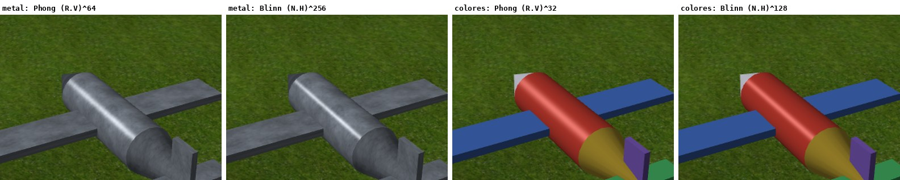

| | Pico del reflejo | Píxeles del reflejo |
|---|---|---|
| Metal, Phong `(R·V)^64` | (226; 233; 243) | 396 (luminancia > 200) |
| Metal, Blinn `(N·H)^256` | (226; 232; 242) | 259 |
| Plástico, Phong `(R·V)^32` | — | 1046 (rojo aclarado) |
| Plástico, Blinn `(N·H)^128` | — | 685 |

El pico es el mismo. Con `ns × 4` el reflejo de Blinn-Phong queda un poco más **chico** (~2/3), pero del mismo orden. Sin el × 4 sería varias veces más ancho.

**5. Distintas actitudes de vuelo.** Se alabeó el avión ~90° (`→`) y se pausó:

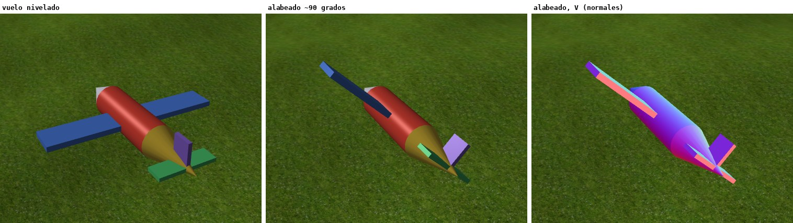

- Las normales giran con el avión, porque la matriz normal incluye la pose.
- El ala que quedó de canto hacia arriba muestra su cara de abajo, que no ve el sol: queda con el ambiente (oscura).
- La deriva, ahora inclinada, muestra su cara iluminada.

La cara iluminada de cada pieza sigue siendo la que mira hacia el sol.

**6. Test por cálculo** (`tests/main_test_normales.cpp`, sin OpenGL), dos pruebas nuevas:
- **Ápice del cono:** en un cono como la nariz, la componente axial de **todas** las normales (también las de la punta) es `sen(semiángulo)`, y hay un ápice por gajo (41 vértices). Con el `Primitives.cpp` anterior la prueba **falla**: diferencia de 0,59 en la punta y 22 vértices.
- **Matriz normal:** el cono unitario con la matriz local de la nariz. La normal de cada vértice de la base tiene que ser perpendicular a su **generatriz** (la recta de la base al ápice, que está sobre la superficie). Con `G` el error es **0°**; con `M`, **41,5°** (la cuenta a mano daba 41,6°).

**7. Además:**
- `make clean && make` compila sin advertencias.
- Pasan los tres tests: `test_rm`, `test_primitives` (con el cono nuevo, todas las caras siguen mirando hacia afuera) y `test_normales`.
- El informe de la consola:

```
[luz]    terreno: usa 8 de 9 uniforms de la escena (no usa: uBlinnPhong)
[luz]    aeronave: usa 8 de 9 uniforms de la escena (no usa: uModoSuelo)
[luz]    fondo: usa 7 de 9 uniforms de la escena (no usa: uOjo, uBlinnPhong)
```

El avión ahora usa todos los uniforms de la escena menos `uModoSuelo`, que es solo del suelo. El terreno y el fondo no usan `uBlinnPhong` porque con `ks = 0` el compilador elimina toda la especular.

---

## Cómo probarlo (Parte 3)

```bash
make clean && make && ./bin/ogl-app
```

(`make clean` hace falta porque cambió `RenderItem.h`, que incluyen varios archivos.)

1. **La consola** muestra las líneas `[luz]` de arriba y la línea de teclas con `V`, `X` y `R`.
2. **Acercar la cámara** (botón derecho, arrastrar hacia arriba) y **pausar** (`ESPACIO`).
3. **V:** las normales como color. Las caras de arriba de las alas, lila. Volver con `V`.
4. **X:** con `V` activa, la nariz y la cola cambian de color y el resto no. Con luz, cambia el brillo de los conos. Volver con `X`.
5. **T:** las tres apariencias. Girar la cámara (botón izquierdo) hasta ver el reflejo del sol en el fuselaje: fino y fuerte en el metal, blanco y mediano en los colores, casi nada en el camuflaje.
6. **R**, con el reflejo a la vista: Phong y Blinn-Phong dan un reflejo de tamaño parecido.
7. **Actitudes:** sacar la pausa, alabear con `←`/`→` y volver a pausar. La cara iluminada sigue siendo la que mira al sol.
8. **Los tests:**

```bash
g++ -std=c++17 -Wall -Wextra -I./src -I./third_party/FastNoiseLite src/core/Primitives.cpp tests/main_test_normales.cpp -o build/test_normales && ./build/test_normales
g++ -std=c++17 -Wall -Wextra -I./src src/core/Primitives.cpp tests/main_test_primitives.cpp -o build/test_primitives && ./build/test_primitives
```

---

## Parte 4 — Niebla exponencial

### Resumen de lo que se agregó (Parte 4)

| Pieza | Qué cambió |
|---|---|
| `iluminacion.glsl` | `aplicar_niebla()` pasa de la lineal (inicio y fin) a la **exponencial**, `f = 1 − e^(−d/V)`. El uniform `uVisibilidad` reemplaza a `uNieblaInicio` y `uNieblaFin`. |
| `fondo.fs` | El **cielo** se mezcla con la niebla en los primeros **5,7°** sobre el horizonte: `f = 1 − smoothstep(0, 0.10, d.z)`. El suelo continuado ya usaba `aplicar_niebla()`. Uniform propio `uNieblaCielo` (tecla `J`). |
| `Iluminacion.h/.cpp` | Campo `visibilidad` en lugar de `niebla_inicio` y `niebla_fin`. El informe `[luz]` cuenta 8 uniforms. |
| `Skybox.h/.cpp` | `ParametrosFondo::niebla_cielo` → `uNieblaCielo`. |
| `main.cpp` | `kVisibilidad = 600 u` (6 km). Tecla **J** (horizonte / gris / cielo sin niebla). Al arrancar informa cuánta niebla hay en el borde del clipmap. Al cambiar la altura (`RePág`/`AvPág`) informa cuánta niebla tiene el suelo más cercano. |

`terreno.fs` y `aeronave.fs` **no cambiaron**: ya llamaban a `aplicar_niebla(color, vPosMundo)` después de la luz desde la Parte 1. Al cambiar la función del código común, los tres programas pasaron a la exponencial **a la vez**. Es justo lo que se buscaba con el código común.

### La fórmula (decisión 4, cumplida acá)

La guía propone la exponencial: `C = (1 − f)·C_luz + f·C_niebla` (que es `mix` de GLSL), con

```
f = 1 − e^(−d/V)
```

- `d` es la distancia **en el espacio** entre el punto y el ojo, `|P − uOjo|`, en mundo. Con el origen flotante, `P` y `uOjo` son relativos al avión, y la resta da lo mismo.
- `V` es la **visibilidad**: a `d = V` la niebla es del **63 %**, a `2V` del 86 %, a `2,5V` del 92 % y a `3V` del 95 %.
- **Por qué es una exponencial:** cada tramo de aire de largo `V` deja pasar la **misma fracción** de la luz del objeto (`e⁻¹` = 37 %). Una capa de aire el doble de gruesa deja pasar 37 % del 37 %.
- **Qué cambia respecto de la lineal del P08** (0 hasta 3 km, 100 % desde 18 km): la exponencial empieza a actuar desde `d = 0` y nunca llega del todo al 100 %. No hay una distancia donde "arranca" la niebla ni un corte donde "termina". Tiene un solo parámetro y una forma que imita la atmósfera.

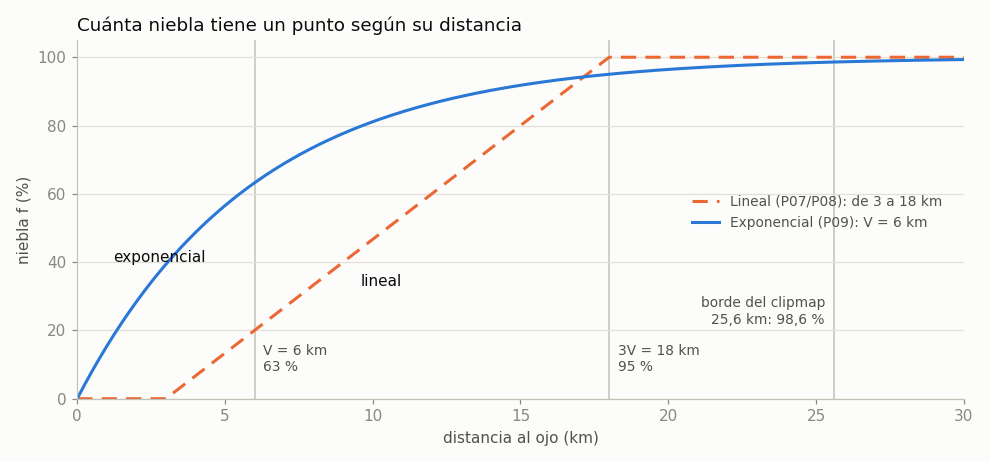

Hasta ~17 km la exponencial pone **más** niebla que la lineal (a 10 km, 81 % contra 47 %): lo cercano también tiene algo de bruma. Más allá pone un poco **menos**, sin el corte al 100 %.

**La niebla va después de la luz.** La niebla es el aire entre el punto y el ojo, no depende del sol ni de la orientación de la superficie: la niebla no se ilumina. Los tres shaders ya lo hacían en ese orden desde la Parte 2: `color = iluminar(...)` y recién después `aplicar_niebla(color, P)`.

### La visibilidad elegida: V = 6 km (decisión 12)

> **Actualización (Parte 5):** con la corrección gamma activa, la visibilidad pasó a **10 km** (decisión 19). Lo de esta sección es el razonamiento de la Parte 4, sin gamma.

La guía pide "dejar escritos los valores elegidos y por qué":

| Dato | Valor | Por qué |
|---|---|---|
| **Visibilidad V** | **600 u = 6 km**, fija | Un día con algo de bruma: el 95 % (casi no se distingue nada) está a 18 km. Es lo que se decidió para empezar (decisión 12). |
| **Tamaño de la "ventana"** | El clipmap del P07: **L = 51,2 km** de lado (5 niveles de 128 × 128 celdas) | No hace falta cambiarlo: es muy grande para esta visibilidad. |
| **Condición de la guía** | `L/2 ≥ 2,5·V`, es decir, 92 % de niebla en el borde | Con `L/2 = 25,6 km`, `V` puede llegar hasta **~10 km**. Con 6 km sobra: en el borde hay **98,6 %** de niebla. |
| **Altitud de vuelo** | ~150 m sobre el terreno (el despeje del P07) | Ahí el terreno conserva el **95 %** del contraste (ver la tabla de abajo). |

**Por qué no la de la guía.** Con la ventana de 2 km de la guía, la visibilidad máxima sería de 400 m, "una niebla muy cerrada para un simulador de vuelo". Gracias al **LOD del Práctico 07**, nuestro terreno cubre 51,2 km de lado (25 veces más) con solo 5 grillas de 129 × 129 vértices, y la visibilidad puede ser 15 veces mayor.

**Por qué no 10 km (el máximo).** El margen entre 6 km y el tope se deja a propósito. Con la **gamma** (Parte 5) cambia el aspecto de la niebla y hay que volver a ajustarla (lo advierte la guía): hay lugar para abrirla sin pasar del borde. Con 10 km, el borde quedaría justo en el 92 %.

**El avión también tiene niebla.** Lo dice la guía: "con una cámara alejada la aeronave también se funde con la lejanía". Con la cámara orbital, el avión está como mucho a 40 u (400 m, `kDistMax`), así que tiene a lo sumo un **6 %** de niebla: casi no se nota, como anticipa la guía.

### La niebla en el cielo, cerca del horizonte

El cubemap no tiene distancias: es una dirección por píxel. Por eso no se puede usar `aplicar_niebla()`. Lo que hace falta es que, **en el horizonte**, el cielo valga lo mismo que el suelo lejano, que ya llega con el color de la niebla (`f → 1` cuando `t → ∞`). La guía propone mezclar el color del cielo con el de la niebla según la **elevación**:

```glsl
// fondo.fs. d unitaria: d.z = sen(elevación) (la guía dice d.y porque usa Y arriba)
float f_cielo = 1.0 - smoothstep(0.0, 0.10, d.z);
cielo = mix(cielo, uNieblaColor, f_cielo);
```

- `smoothstep(0, 0.10, d.z)` sube de 0 a 1, con forma de **S** (sin quiebres), mientras `d.z` va de 0 a 0,10. Eso es entre 0° y `asin(0,10)` = **5,7°** de elevación.
- **En el horizonte**, `f_cielo = 1`: el cielo vale exactamente el color de la niebla, igual que el suelo lejano. No queda ninguna línea.
- **Desde 5,7° hacia arriba** el cielo queda como está: las nubes se ven igual.
- **Debajo del horizonte** también vale 1. Si el suelo continuado está apagado (`G`), esa zona queda del color de la niebla.
- **Con la niebla apagada** (`N`) no se mezcla.

**Arregla la línea del Práctico 08** (`Practico08-Consultas.md`, pregunta 22). El suelo llegaba al horizonte con el color **promedio** del horizonte, y el cielo justo arriba tenía el color del cubemap **en esa dirección** (nubes más claras u oscuras). Eran dos colores distintos que se tocaban sin mezclarse: una línea recta. Ver la imagen de la tecla `J`, abajo.

### El color de la niebla

No cambió: desde el P08 es el **color del horizonte** del cubemap, el promedio de la fila central de las cuatro caras laterales, calculado una vez en la CPU (`Skybox::color_horizonte()`): (0,767; 0,818; 0,896). Con el degradé de la tecla `K` es el mismo color, porque el degradé arranca en ese horizonte. La Parte 5 lo pasa a lineal en la CPU: (0,559; 0,642; 0,786).

### La tecla J

Recorre tres modos:

| `J` | Color de la niebla | Cielo | Para qué |
|---|---|---|---|
| 0 (inicial) | Horizonte del cielo | Con niebla en los primeros 5,7° | Lo correcto. |
| 1 | **Gris** (0,5) | Con niebla (gris) | La verificación de la **guía**: con un color que no es el del cielo, aparece una **franja** sobre el horizonte. |
| 2 | Horizonte del cielo | **Sin** niebla, como el P08 | Ver la **línea recta** del horizonte que arregla la mezcla del cielo. |

La decisión 13 preveía `J` solo para la niebla gris. Se le agregó el tercer modo porque es la única forma de **ver** la mezcla del cielo: sin él, no hay con qué comparar. `N` sigue siendo niebla sí/no (`uVisibilidad = 0`).

### La altitud

La guía advierte: la niebla usa la distancia **en el espacio**, no la horizontal. A una altura `h`, el punto más cercano del terreno, el de abajo, ya está a `d = h`. Entonces **ningún** punto del terreno tiene menos niebla que `f = 1 − e^(−h/V)`. Si `h` es comparable a `V`, todo el terreno queda tapado.

Para anotarlo, el mensaje de `RePág`/`AvPág` informa ese mínimo:

```
[altura] ojo a 1544.72 m sobre el terreno -> banda teorica: ...; niebla del suelo mas cercano 23 %
```

**Lo medido.** Con la cámara mirando hacia abajo (~35°), se comparó el detalle del terreno (el desvío de la luminancia respecto de un promedio local) con y sin niebla, a varias alturas:

| Altura sobre el terreno | Contraste del terreno que queda | Teórico abajo, `e^(−h/V)` |
|---|---|---|
| 0,2 km (vuelo normal) | **95 %** | 97 % |
| 1,2 km | 77 % | 83 % |
| 2,2 km | 62 % | 70 % |
| 3,2 km | **50 %** | 59 % |
| 6,2 km | 27–43 % | 36 % |

La cámara mira en diagonal, así que los puntos están algo más lejos que `h` y queda un poco menos que el teórico.

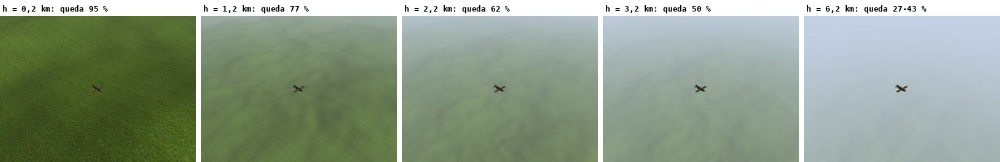

**A qué altura empieza a perderse.** Con V = 6 km, a **~1 km** el terreno ya se ve con bruma (queda el 77 %). Alrededor de **3 km** pierde la **mitad** del contraste. Mirando hacia el horizonte se pierde antes, porque los puntos están más lejos: desde 3,2 km, casi todo lo que se ve por debajo del horizonte es niebla (imagen del punto 2 de la verificación).

**Visibilidad según la altitud: no, por ahora** (decisión 12: "solo si al subir el terreno se pierde demasiado pronto"). El avión vuela a ~150 m del terreno, donde queda el 95 %. Las alturas de más de 1 km sobre el terreno solo se alcanzan a propósito, con `RePág`. Si con la gamma (Parte 5) la bruma a 1–2 km resulta exagerada, el ajuste es primero abrir `V` (hasta ~10 km); recién después, que `V` crezca con la altitud.

### Verificación

**1. La franja con la niebla gris y la línea del horizonte (tecla J)**, a 200 m y a 1,5 km sobre el terreno, desde la misma cámara:

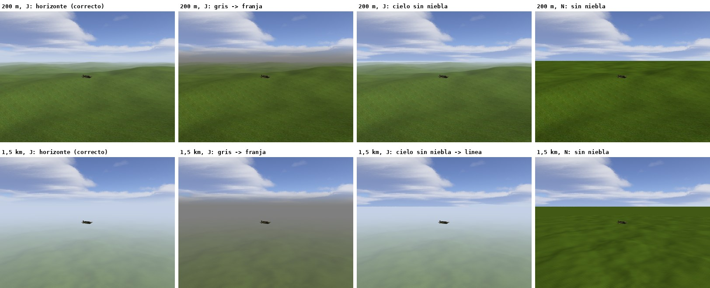

- **Horizonte (correcto):** el terreno lejano se funde con el cielo sin ningún corte.
- **Gris:** aparece una **franja gris** sobre el horizonte. Es la verificación de la guía: el terreno lejano tiende al gris y el cielo no, así que no coinciden. Con el color del horizonte, desaparece.
- **Cielo sin niebla:** vuelve la **línea recta** del P08 entre el suelo lejano (color promedio) y el cielo (el color del cubemap en cada dirección). A 1,5 km se ve clara.
- **Sin niebla (`N`):** el terreno llega con su color hasta el horizonte. La recta horizontal es el suelo continuado contra el cielo.

**2. El borde del clipmap, con y sin niebla**, desde 3,2 km, donde el borde queda a 7° por debajo del horizonte:

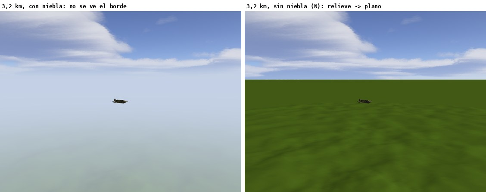

Sin niebla se ve dónde **termina el relieve** de la malla y empieza el plano del suelo continuado (la textura deja de variar). Con niebla no se distingue: en el borde hay 98,6 % de niebla, y la malla y el suelo continuado reciben la **misma** niebla (la misma función y la misma distancia).

**3. La altitud:** la tabla y la imagen de arriba.

**4. Además:**
- `make clean && make` compila sin advertencias. Los tests no cambian (la niebla no tiene código de CPU que probar).
- Al arrancar, la consola informa la visibilidad y la niebla en el borde:

```
niebla   : exponencial, V = 6000 m (63 % a V, 95 % a 3V); en el borde del clipmap (25600 m): 98.6 %
[luz]    terreno: usa 7 de 8 uniforms de la escena (no usa: uBlinnPhong)
[luz]    aeronave: usa 7 de 8 uniforms de la escena (no usa: uModoSuelo)
[luz]    fondo: usa 6 de 8 uniforms de la escena (no usa: uOjo, uBlinnPhong)
```

`uVisibilidad` reemplazó a `uNieblaInicio` y `uNieblaFin`, por eso son 8 y no 9. El fondo sigue sin usar `uOjo`: la distancia de su suelo es `|P − uOjo|` con `P = uOjo + t·d`, y el compilador la simplifica a `t`.

---

## Cómo probarlo (Parte 4)

```bash
make clean && make && ./bin/ogl-app
```

(`make clean` hace falta porque cambiaron `Iluminacion.h` y `Skybox.h`, que incluyen varios archivos.)

1. **La consola** muestra la línea `niebla   : exponencial, V = 6000 m ...` y la tecla `J` en la línea de teclas.
2. **Pausar** (`ESPACIO`) y **bajar la cámara** hasta ver el horizonte (botón izquierdo, arrastrar hacia arriba).
3. **J** tres veces: horizonte → gris (franja) → cielo sin niebla (línea) → horizonte. Se nota más después de subir un poco: `RePág` unas 10 veces (1 km).
4. **N:** sin niebla, el terreno llega hasta el horizonte con su color.
5. **El borde:** `RePág` hasta ~3 km y mirar hacia el horizonte con y sin `N`.
6. **La altitud:** subir con `RePág` y mirar el mensaje `[altura] ... niebla del suelo mas cercano X %`.

---

## Parte 5 — Corrección gamma

### Resumen de lo que se agregó (Parte 5)

| Pieza | Qué cambió |
|---|---|
| `iluminacion.glsl` | Las dos conversiones de la guía, `a_lineal(c)` = `c^2,2` y `a_srgb(c)` = `c^(1/2,2)`, con `const float GAMMA = 2.2`. Uniform `uGamma` (tecla `C`): con 0, las dos devuelven el color tal cual. |
| `terreno.fs` | `kd = a_lineal(textura o color plano)` y, al final, `FragColor = a_srgb(color)` (después de la niebla). |
| `aeronave.fs` | `kd = a_lineal(uMaterial.kd) · a_lineal(textura)` y `a_srgb` al final. `ks` no se convierte. Las normales de la tecla `V` tampoco. |
| `fondo.fs` | `cielo = a_lineal(cubemap o degradé)`; el pasto del suelo continuado, `a_lineal`; `a_srgb` al final. |
| `Iluminacion.h/.cpp` | Campo `gamma` → `uGamma` (el informe `[luz]` cuenta 9 uniforms). Valores nuevos: **sol 0,9 y ambiente 0,1** (decisión 18). |
| `main.cpp` | El color de la niebla se pasa a lineal en la CPU (`glm::pow(c, 2,2)`). **`kVisibilidad = 1000 u`** (10 km, decisión 19). Tecla **C**. Al arrancar informa la gamma y el color de la niebla en lineal. |
| `Texture.h` | Solo el comentario: las texturas siguen en `GL_RGBA8` a propósito (la conversión la hace el shader). |

### El problema y la solución

Las cuentas de la luz (`kd · luz · cos θ`, sumar ambiente + difusa + especular) y la mezcla de la niebla suman y multiplican **intensidades de luz**. Solo valen si los números son **proporcionales** a la luz (escala lineal). Pero la pantalla no es lineal: un valor `v` se ve con una intensidad ~ `v^2,2`. Por eso las imágenes y los colores elegidos a ojo vienen en **sRGB**, comprimidos con la curva inversa: así se ven bien sin hacer nada.

**El ejemplo de la guía:** una cara con `N·L = 0,5` recibe la mitad de la luz. Sin corrección se escribe 0,5 y la pantalla muestra `0,5^2,2` = **0,22**: menos de la cuarta parte. La sombra llega demasiado rápido. Con la corrección se escribe `0,5^(1/2,2)` = 0,73, y la pantalla muestra 0,5: justo la mitad.

La corrección son **dos pasos en cada fragment shader**: pasar a lineal cada color que **entra** en las cuentas y, al final de todo (después de la niebla), pasar el resultado a sRGB. Las dos funciones están en el código común, como propone la guía:

```glsl
const float GAMMA = 2.2;
vec3 a_lineal(vec3 c) { return (uGamma == 1) ? pow(c, vec3(GAMMA)) : c; }         // sRGB -> lineal
vec3 a_srgb(vec3 c)   { return (uGamma == 1) ? pow(c, vec3(1.0 / GAMMA)) : c; }   // lineal -> sRGB
```

La única diferencia con la guía es el `uGamma` adentro: con la tecla `C` las dos devuelven el color tal cual. Así los shaders se escriben una vez, con las conversiones, y la tecla no los cambia.

### Qué se convierte y qué no

La regla de la guía: no importa si un valor sale de una imagen o se escribió a mano, sino **qué representa**. Un color elegido por cómo se ve en la pantalla está en sRGB.

| Valor | ¿Se pasa a lineal? | Dónde | Por qué |
|---|---|---|---|
| Textura del pasto (malla y suelo continuado) | **Sí** | `terreno.fs`, `fondo.fs` | Es una foto: sRGB. |
| Color plano por nivel (tecla `L`) | **Sí** | `terreno.fs` | Se eligió mirando la pantalla. |
| Cubemap y degradé del cielo | **Sí** | `fondo.fs` | El cielo no se ilumina, pero pasa por `a_srgb` al final. Sin `a_lineal` se vería **lavado**. |
| `kd` de las piezas del avión | **Sí** | `aeronave.fs` | Se eligió en el P04 mirando la pantalla sin corrección. Sin convertirlo, la pieza se vería más clara y desaturada. |
| Texturas del avión (camuflaje, chapa, prueba UV) | **Sí** | `aeronave.fs` | Son imágenes. |
| Color de la niebla | **Sí**, en la **CPU** | `main.cpp` | Es un promedio de píxeles del cubemap (sRGB). Se convierte **una vez por cuadro** con `glm::pow`, como sugiere la guía, en lugar de un `pow` por fragmento. Sin convertirlo vuelve la franja sobre el horizonte. |
| `uSolColor`, `uAmbiente` | No | — | Son **proporciones** de luz que se suman (0,9 + 0,1 = toda la luz): ya son lineales. |
| `ks` | No | — | Es la fracción de la luz que se refleja como brillo. |
| Normales como color (tecla `V`) | No | — | Son un **dato** (una dirección codificada como color), no un color. |
| Color de borrado (`glClearColor`) | No | `main.cpp` | `glClear` lo escribe **directo** en la pantalla, sin pasar por ningún shader ni por `a_srgb`. Se usa el color de la niebla en sRGB. |

`kd · textura` en el avión: como `(a·b)^2,2 = a^2,2 · b^2,2`, da lo mismo convertir cada uno o el producto. En el código se convierte cada uno, porque sin textura (apariencia "colores") solo está `kd`.

### En el shader y no por hardware (decisión 11)

La guía plantea las dos opciones: hacerlo con `pow` en el shader, o con texturas `GL_SRGB8_ALPHA8` (la GPU convierte a lineal al leer) más `glEnable(GL_FRAMEBUFFER_SRGB)` (la GPU convierte a sRGB al escribir). Se eligió **el shader**:

- se puede **apagar con una tecla** (C) para comparar, como pide la verificación;
- no depende de que la ventana admita un framebuffer sRGB (`GLFW_SRGB_CAPABLE` y el controlador);
- se ve, en el código, dónde se convierte cada color.

**El cuidado que pide:** las texturas siguen en `GL_RGBA8` (`srgb = false` en `Texture::load_2d` / `load_cubemap`, que ya tenía el parámetro desde el P08) y `GL_FRAMEBUFFER_SRGB` no se activa. Si además se activara el camino por hardware, la conversión se haría **dos veces**.

**Lo que se pierde:** con texturas sRGB la GPU convierte **antes** de filtrar (mipmaps, bilineal) y promedia en lineal. Con `pow` en el shader, el filtrado promedia valores sRGB y recién después se convierte. La diferencia solo se nota en bordes muy contrastados vistos de lejos; en el pasto y en el cielo no se ve. Ver la consulta 17.

### El reajuste de la luz y de la niebla (decisiones 18 y 19)

La guía advierte: *"la luz ambiente de la Parte 2 y la visibilidad de la Parte 4 hay que volver a ajustarlas con la corrección activa"*. Se midió con dos teclas temporales (ya borradas) que cambiaban los valores sobre **el mismo cuadro**.

**La luz ambiente.** Con 0,3 de ambiente, la cara en sombra se ve al `0,3^(1/2,2)` = **58 %** del color de la textura (sin corrección se veía al 30 %): el relieve se aplana. Medida en el terreno, la relación entre la parte en sombra y la iluminada (percentiles 10 y 90 de la luminancia; más bajo = más relieve):

| Configuración | Sombra/luz | Cara en sombra (teórico) |
|---|---|---|
| Sin gamma, ambiente 0,3 (Parte 4) | 0,77 | 30 % |
| Gamma, ambiente 0,30 / sol 0,70 | 0,90 | 58 % |
| Gamma, ambiente 0,20 / sol 0,80 | 0,86 | 48 % |
| Gamma, ambiente 0,15 / sol 0,85 | 0,85 | 42 % |
| **Gamma, ambiente 0,10 / sol 0,90** | **0,84** | **35 %** |

**Decisión 18: ambiente 0,10 y sol 0,90.** La cara en sombra queda casi como antes (35 % contra 30 %) y el relieve recupera lo que se puede. Siguen sumando 1, así que una cara de frente al sol llega justo a `kd` y no se quema. Con la corrección, el relieve nunca vuelve del todo al de la Parte 4: es lo que dice la guía, *"la transición hacia la sombra se vuelve más gradual"*.

De paso, el terreno plano queda **más claro** que en la Parte 4. Con el sol a 30°, `N·L` = 0,5: antes se veía al 65 % de la textura; ahora, al `(0,1 + 0,9·0,5)^(1/2,2)` = **76 %**. Es más parecido al Práctico 08 (consulta 3: "¿por qué con luz el terreno se ve más oscuro?"): la mitad de esa diferencia era la falta de la corrección.

**La visibilidad.** Con la corrección, la niebla se mezcla **en lineal** y, con la misma `V`, se ve **bastante más espesa**. Un poco de un color claro (la niebla), mezclado en lineal, aclara mucho un color oscuro (el pasto) en la pantalla. Con el pasto en 0,30 y la niebla en 0,82 (sRGB), un 10 % de niebla lo corre un **18 %** hacia la niebla en la pantalla; un 30 %, un 43 % (consulta 16). Medido como en la Parte 4 (el detalle del terreno con y sin niebla, mirando hacia abajo), en el **mismo** cuadro:

| Altura sobre el terreno | Parte 4 (sin gamma, V 6 km) | Gamma, V 6 km | Gamma, V 8 km | **Gamma, V 10 km** |
|---|---|---|---|---|
| 0,2 km (vuelo normal) | 95 % | 79 % | 83 % | **86 %** |
| 1,2 km | 79 % | 53 % | 59 % | **64 %** |
| 3,2 km | 54 % | 29 % | 36 % | **42 %** |
| Niebla en el borde del clipmap (25,6 km) | 98,6 % | 98,6 % | 95,9 % | **92,3 %** |

**Decisión 19: V = 10 km** (`kVisibilidad = 1000 u`). Es el **máximo** que permite el clipmap (`L/2 ≥ 2,5·V` → `V ≤ 10,2 km`), y es la que deja el terreno más parecido a la Parte 4. En el borde queda justo el 92,3 % que pide la guía; con la mezcla en lineal se percibe todavía más. Se comprobó a 3,2 km que el borde **no se ve** (como en la verificación 2 de la Parte 4). El margen que se había dejado en la Parte 4 ("por qué no 10 km") era para esto.

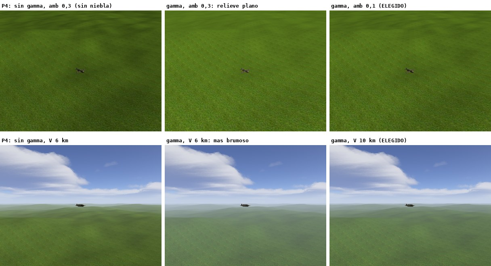

Arriba, sin niebla: con la corrección y el ambiente en 0,3 el relieve se aplana; con 0,1 vuelve. Abajo, el horizonte a 200 m: con la corrección y 6 km el terreno queda lavado; con 10 km se parece a la Parte 4.

**La altitud, actualizada** (lo que pide anotar la guía, con la corrección activa): con V = 10 km, a **~1 km** sobre el terreno queda el 64 % del contraste y a **~3 km**, el 42 %. A la altura de vuelo (~150–200 m) queda el **86 %**. Visibilidad según la altitud: sigue sin hacer falta (decisión 12).

**Con `C` apagada no se vuelve exactamente a la Parte 4:** el ambiente (0,1) y la visibilidad (10 km) son los nuevos para los dos casos. Sin corrección, las sombras quedan casi negras (al 10 %). Es lo esperable: esos valores son proporciones de luz lineales, y sin la corrección se usan mal.

### Verificación

**1. La misma vista con y sin la corrección (tecla C).** El terreno, el horizonte y el cielo, desde la misma cámara:

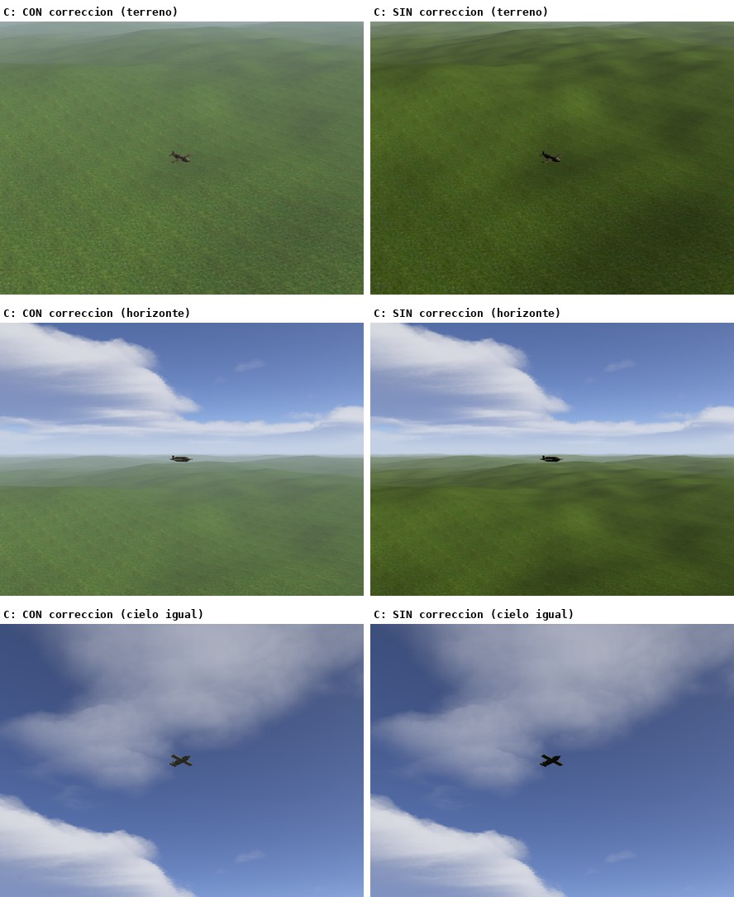

- **El cielo se ve igual**, como pide la guía: `a_srgb(a_lineal(c)) = c`. Medido sobre la vista del cielo, la diferencia media entre las dos imágenes es **0,04 sobre 255** (fuera del avión).
- **La transición a la sombra es más gradual** y la cara en sombra, más clara: con la corrección se ve el relieve en la sombra; sin ella (con el ambiente en 0,1) queda casi negra. La **panza del avión** (tercera fila) lo muestra mejor: con la corrección se ve el camuflaje; sin ella, es una silueta oscura.
- **No hay franja sobre el horizonte** con la corrección activa (segunda fila).

**2. El avión, con sus tres apariencias** (tecla `T`):

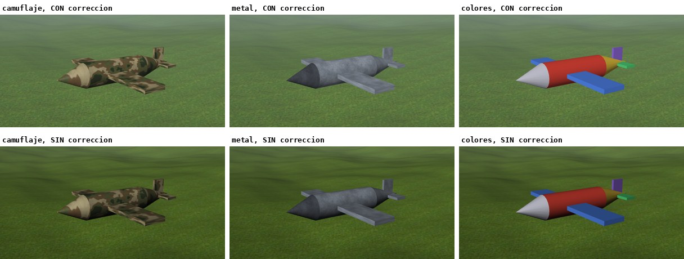

Las partes que miran al sol mantienen el color (con la luz sumando 1, una cara de frente al sol llega a `kd` con y sin corrección). Lo que cambia es la **transición**: en el fuselaje (un cilindro) la luz pasa a la sombra de a poco, y el lado en sombra conserva el color. Sin la corrección, el cilindro se ve casi como dos mitades, una clara y otra oscura.

**3. Las dos fallas que describe la guía**, provocadas a propósito en una **copia** de los shaders (en el scratchpad; los del proyecto no se tocaron):

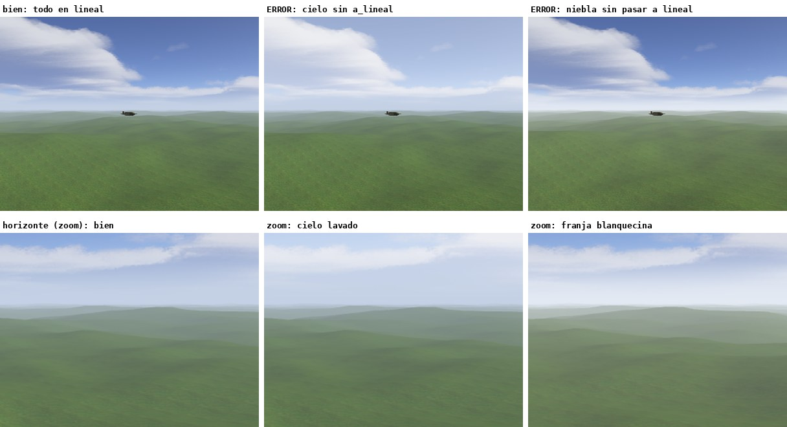

- **Cielo sin `a_lineal`:** *"si con la corrección se ve más pálido, falta pasar el color del cubemap a lineal"*. El cielo sale **lavado**: más claro y desaturado.
- **Color de la niebla sin pasar a lineal:** *"si aparece [la franja], falta pasar el color de la niebla a lineal"*. El terreno lejano y el cielo cerca del horizonte llegan a un color **más claro** que el del cielo de arriba: una **franja blanquecina** (226, 233, 243 contra 196, 208, 229 cuando está bien).

**4. Además:**
- `make clean && make` compila sin advertencias. Los tests (`test_rm`, `test_primitives`, `test_normales`) pasan.
- Al arrancar, la consola informa:

```
[luz]    terreno: usa 8 de 9 uniforms de la escena (no usa: uBlinnPhong)
[luz]    aeronave: usa 8 de 9 uniforms de la escena (no usa: uModoSuelo)
[luz]    fondo: usa 7 de 9 uniforms de la escena (no usa: uOjo, uBlinnPhong)
niebla   : exponencial, V = 10000 m (63 % a V, 95 % a 3V); en el borde del clipmap (25600 m): 92.3 %
gamma    : 2.2 en el shader (a_lineal / a_srgb); niebla en lineal = (0.558515, 0.642112, 0.78563); C la apaga
```

Los tres programas usan `uGamma` (los tres llaman a `a_srgb` al final).

---

## Cómo probarlo (Parte 5)

```bash
make clean && make && ./bin/ogl-app
```

(`make clean` hace falta porque cambió `Iluminacion.h`, que incluyen varios archivos.)

1. **La consola** muestra la línea `gamma    : 2.2 en el shader ...`, la niebla con `V = 10000 m` y la tecla `C` en la línea de teclas.
2. **Pausar** (`ESPACIO`) y apretar **C** varias veces: con la corrección, el terreno se ve más claro y las sombras más suaves; sin ella, las sombras quedan casi negras.
3. **El cielo:** bajar la cámara hasta ver el cielo (botón izquierdo, arrastrar hacia arriba) y apretar **C**: el cielo no cambia, solo la panza del avión.
4. **El avión:** acercar la cámara (botón derecho, arrastrar hacia arriba), girarla para verlo de costado y apretar **C** con cada apariencia (**T**).
5. **El horizonte:** con la corrección activa, mirar el horizonte y apretar **J** para el gris: aparece la franja; con el color del horizonte, desaparece.

---

## Opcional 1 — Halo del sol

Con la Parte 5 terminan las partes obligatorias del Práctico 09. Siguen los opcionales, en el orden de la decisión 14: halo del sol → día/noche → curvatura de la Tierra. **La guía no pide el halo:** es una mejora propia (`Practico09-Pendientes.md`, sección 9).

### Resumen de lo que se agregó (halo)

| Pieza | Qué cambió |
|---|---|
| `fondo.fs` | `halo_sol(d)`: un **disco** de 2° y un **resplandor** (corona y aureola) alrededor de `uSolDir`, sumados al cielo en lineal. La mezcla del cielo con la niebla usa `color_niebla(d)`. |
| `iluminacion.glsl` | `color_niebla(dir)`: el color de la niebla **se aclara hacia el sol**. `aplicar_niebla()` lo usa con la dirección del ojo al punto. Uniform `uHalo` (tecla `Y`). |
| `Iluminacion.h/.cpp` | Campo `halo` → `uHalo`. El informe `[luz]` cuenta 10 uniforms. |
| `main.cpp` | Tecla **Y** (completo / solo el cielo / sin halo). Al arrancar informa el halo. |

### Lo que se encontró antes de empezar: el sol pintado

El sol del cubemap **no es un disco**: es una zona grande de nubes **blancas saturadas** (en la cara izquierda del cubemap hay unos 125 000 píxeles con brillo ≥ 250 de 255) con rayos que salen de ella. Eso define dónde se ve el halo:

| Situación | Sol pintado (parte de la foto) | Halo (lo dibuja el shader en `uSolDir`) | Qué se ve |
|---|---|---|---|
| Al arrancar, o después de **H** (luz a 29,8°) | a 29,8° | a 29,8°, encima del pintado | **Un sol**: el halo queda escondido adentro, porque blanco + luz sigue siendo blanco |
| Con **O/P** (por ejemplo, luz a 5°) | sigue a 29,8°: es una imagen | a 5°, donde está la luz | **Dos soles**: el pintado, que ya no ilumina nada, y el halo, que marca de dónde viene la luz |
| Degradé (**K**) | no hay | en la dirección de la luz | **Un sol**: el halo |

El halo no es el sol pintado: es un sol aparte, que siempre está donde está la luz. Para que nunca hubiera dos, habría que borrar el sol de las imágenes del cubemap (consulta 20).

### El halo en el cielo (decisiones 20, 21 y 22)

Todo se mide con el **ángulo** entre la dirección del píxel `d` y la del sol: `coseno = d · uSolDir`.

| Parte | Cómo se calcula | Ancho | Brillo (× `uSolColor`) |
|---|---|---|---|
| **Disco** | `1 − smoothstep(0,92°, 1,08°, ángulo)`: 1 adentro, 0 afuera, borde suavizado en ~2 px | radio **1°** (diámetro 2°, ~25 px; el real mide 0,53°) | 20: satura a blanco |
| **Corona** | `max(coseno, 0)^500` | cae a la mitad a ~3° | 0,15 |
| **Aureola** | `max(coseno, 0)^40` | cae a la mitad a ~11° | 0,12 |

- **El tamaño (decisión 21).** Se probó primero el real, 0,53° (~7 px): se veía **muy chico**. El sol que percibimos parece más grande porque encandila, y la pantalla no puede reproducir ese brillo; se agrandó a 2°. Medido sobre el degradé: **~29 px** (los 25 de 2°, el borde suavizado y un poco más porque el sol cae lejos del centro de la pantalla, donde la perspectiva estira). Con el disco más grande la corona quedaba casi toda adentro: se ensanchó de `^2000` (mitad a ~1,5°) a `^500` (mitad a ~3°).
- **El borde suavizado** hace falta porque el MSAA solo suaviza los bordes de los triángulos, no lo que el shader pinta adentro de uno: un disco con borde duro se vería escalonado.
- **El resplandor es suave a propósito.** El primer intento tenía la corona en 1,0. El cielo ya es claro (el azul del degradé alrededor del sol vale ~0,87 en pantalla, ~0,7 en lineal) y todo alrededor del sol se recortaba a blanco: una mancha de **34 px** (~2,7°) que escondía el disco, que todavía medía 0,53°. Con ~0,25 junto al borde del disco, alrededor queda un celeste muy claro y el disco se distingue.
- **Se suma en lineal**, después de `a_lineal(cielo)` y antes de `a_srgb`: es luz. Sin la corrección gamma (`C`), la misma suma sobre valores sRGB se ve mucho más fuerte y tapa el disco.
- **Proporcional a `uSolColor`:** si el sol cambia de color o se apaga, el halo lo sigue.

### La bruma hacia el sol (decisión 23)

El aire dispersa la luz sobre todo **hacia adelante**, pocos grados respecto de la dirección en que venía. Por eso, mirando hacia el sol, el aire brilla: es el halo alrededor del sol, y es también la bruma luminosa del horizonte a contraluz. Se imita sumándole al color de la niebla un brillo que crece cuando la vista se acerca al sol:

```glsl
// iluminacion.glsl. dir: del ojo hacia el punto (unitaria); L = uSolDir.
color(dir) = uNieblaColor + uSolColor · 0,5 · max(dir · L, 0)^8     // solo con Y en "completo"
```

- **Ancho:** con exponente 8, el brillo cae a la mitad a ~23° del sol y casi no queda a 60°. Es mucho más ancho que el halo del cielo: es el aire de muchos kilómetros.
- **Quién lo usa:** `aplicar_niebla()` (terreno, avión y suelo continuado, con la dirección del ojo al punto) y la mezcla del cielo cerca del horizonte en `fondo.fs` (con `d`). Como el suelo lejano y el cielo del horizonte usan la **misma** función con la **misma** dirección, en el horizonte valen lo mismo: **no hay costura**, aunque el sol esté bajo.
- **El halo del cielo se suma antes de la mezcla con la niebla:** cerca del horizonte se funde como el resto del cielo, y no queda cortado en seco contra el suelo.
- **En la vista normal** casi no se nota. Mirando de espaldas al sol no cambia nada (diferencia 0,0). Mirando hacia el sol, con el sol en su lugar (29,8°), la franja del horizonte se aclara unos 11 niveles de 255 (14 del lado del sol). Donde más se nota es con el sol **bajo**: el horizonte hacia el sol queda luminoso, como al atardecer.

### La tecla Y

| `Y` | Halo del cielo | Bruma hacia el sol | Para qué |
|---|---|---|---|
| 0 (inicial) | Sí | Sí | Lo completo. |
| 1 | Sí | No | Ver qué aporta la bruma: con el sol bajo, el resplandor **se apaga** contra el horizonte y el disco se hunde en la bruma; el horizonte no brilla. |
| 2 | No | No | Como la Parte 5. |

### Verificación

**1. Dónde se ve el halo**, con la cámara apuntando al sol:

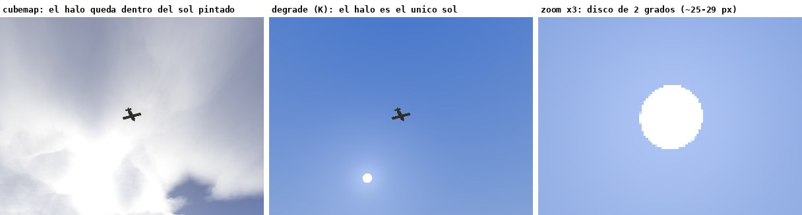

Con el cubemap, el halo queda adentro del sol pintado y no cambia nada. Con el degradé (`K`), que no tiene sol, el halo es el sol: un disco de ~29 px con un resplandor suave.

**2. El sol bajo (O/P) con el cubemap**, con los tres modos de `Y`:

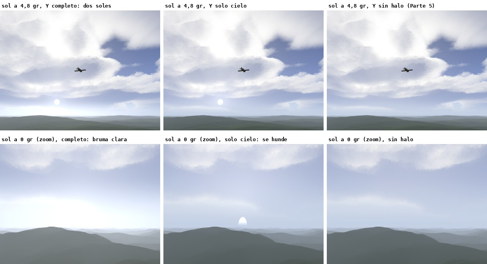

- **Arriba, sol a 4,8°:** se ven **dos soles**, el pintado (la mancha blanca de arriba a la izquierda) y el disco del halo cerca del horizonte. Con "completo", además, la bruma del horizonte se aclara hacia el sol.
- **Abajo, sol a 0° (zoom del horizonte):** con "completo" el horizonte brilla hacia el sol; con "solo el cielo" el horizonte no brilla y del disco queda la mitad de arriba, hundiéndose en la bruma (es tan brillante que la niebla del horizonte recién lo tapa en el último grado); sin halo, es la Parte 5.
- **Sin costura:** el perfil vertical bajo el sol tiene los mismos saltos con y sin halo, y son siluetas de lomas contra la bruma, que ya estaban en la Parte 5. El halo no agrega ningún corte en el horizonte.

**3. El atardecer sobre el degradé y la vista normal:**

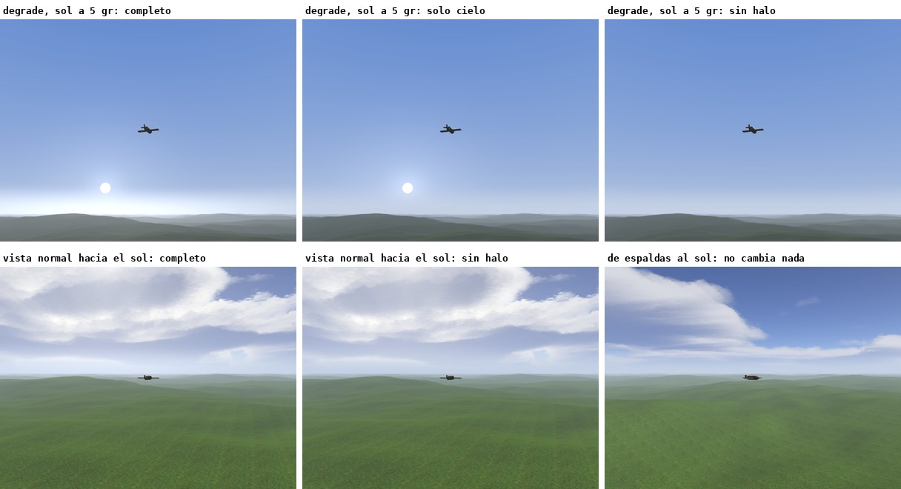

Arriba: el sol a 5° sobre el degradé, con los tres modos. Abajo: la vista normal girada hacia el lado del sol (la bruma apenas más clara) y de espaldas al sol (sin ningún cambio).

**4. Además:**
- Con **J** en gris la franja sobre el horizonte sigue apareciendo: la verificación de la Parte 4 no se rompió (la bruma se suma al gris).
- `make clean && make` compila sin advertencias; los tests pasan.
- La consola, al arrancar:

```
[luz]    terreno: usa 9 de 10 uniforms de la escena (no usa: uBlinnPhong)
[luz]    aeronave: usa 9 de 10 uniforms de la escena (no usa: uModoSuelo)
[luz]    fondo: usa 8 de 10 uniforms de la escena (no usa: uOjo, uBlinnPhong)
halo     : disco de 2 grados + resplandor en la direccion de la luz; bruma mas clara hacia el sol; Y cambia el modo
```

Los tres programas usan `uHalo`: los tres usan la niebla, y la niebla ahora depende del modo del halo.

### Lo que no se puede arreglar sin editar el cubemap

- **Dos soles con O/P:** el sol pintado es parte de la foto y no se mueve.
- **El halo se dibuja encima de las nubes:** aunque la luz quede detrás de una nube del cubemap, el disco se ve igual. La imagen no dice qué tan gruesa es cada nube.

---

## Cómo probarlo (halo)

```bash
make clean && make && ./bin/ogl-app
```

(`make clean` hace falta porque cambió `Iluminacion.h`.)

1. **La consola** muestra la línea `halo     : ...` y la tecla `Y` en la línea de teclas.
2. **El sol sobre el degradé:** pausar (`ESPACIO`), apretar **K** (degradé) y girar la cámara (botón izquierdo) hasta encontrar el disco con su resplandor. Con el cubemap (**K** de nuevo), ahí está el sol pintado.
3. **Dos soles:** volver al cubemap, apretar **O** 4 o 5 veces (sol a 10° o 5°) y mirar hacia el horizonte de ese lado: el disco aparece abajo del sol pintado.
4. **La tecla Y** con el sol bajo: completo (el horizonte brilla hacia el sol) → solo el cielo (el horizonte no brilla y el disco se hunde en la bruma) → sin halo.
5. **H** vuelve el sol a su lugar: un solo sol otra vez.

---

## Lo que sigue: día/noche y curvatura

1. **Ciclo día/noche:** el opcional de la guía (el sol gira, se pone anaranjado y se apaga debajo del horizonte; el cielo y la niebla se oscurecen). El halo ya sigue a `uSolColor` y a `uSolDir`: va a ser el sol que se mueve, y la bruma hacia el sol, el brillo del atardecer.
2. **Curvatura de la Tierra:** el horizonte que baja al subir.
