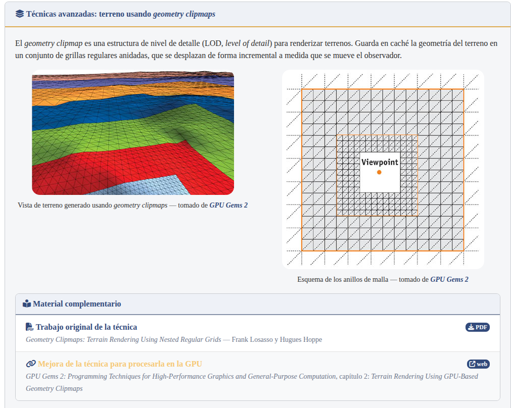
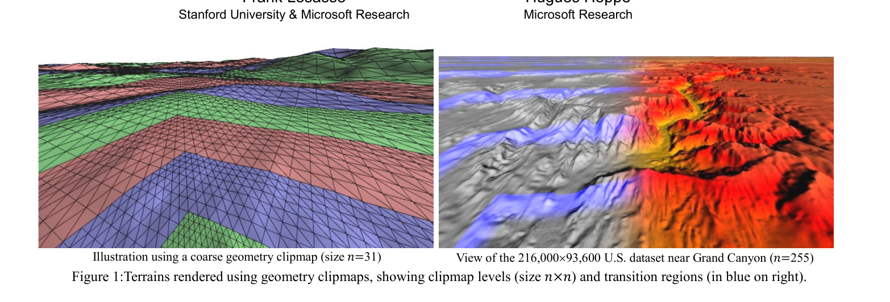
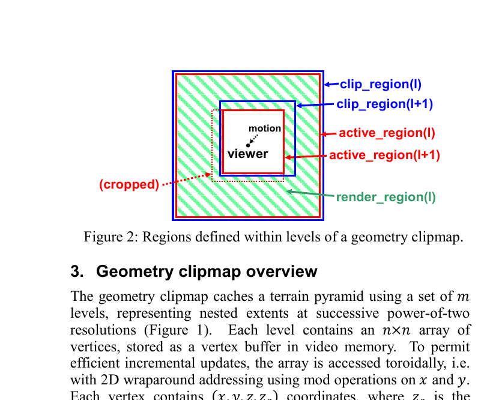
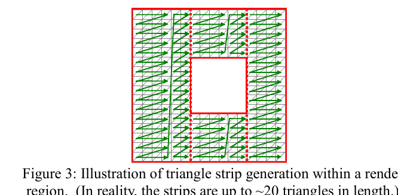
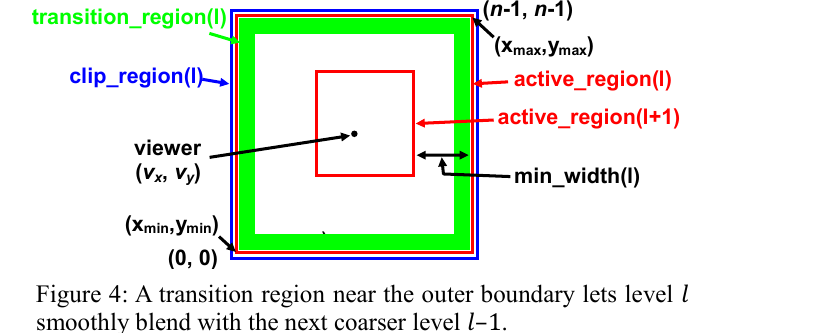
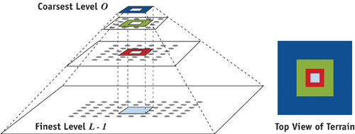
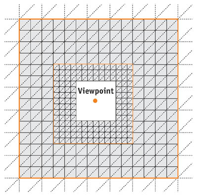
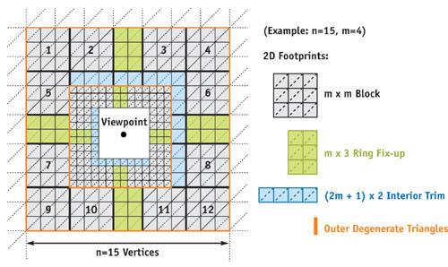

# Geometry clipmaps: niveles de detalle para el terreno (Práctico 07)

> Los niveles de detalle (etapas 1 y 2) son parte del **Práctico 07** (terreno).
> La **niebla** (sección 12) es una **mejora leve** que adelanta un tema del
> **Práctico 09**; ahí se va a mejorar.

Material usado:
- `Geometry-clipmaps.png`: la diapositiva de la clase.
- `P07-Losasso-Hoppe - Geometry Clipmaps...pdf`: el paper de Losasso y Hoppe (SIGGRAPH 2004).
- `Terreno usando geometry clipmaps`: la nota de texto, con el link a GPU Gems 2, capítulo 2.

---

## 1. El problema

En el Práctico 07 el terreno es **una sola grilla de N×N celdas con separación constante**. El costo crece con el área: para ver el doble de lejos con el mismo detalle hace falta 4 veces más triángulos. Ese detalle además se desperdicia, porque lejos del avión un triángulo de 25 m ocupa menos de un píxel.

Lo que queremos es **mucho detalle cerca del observador y poco detalle lejos**. Eso se llama **nivel de detalle (LOD, *level of detail*)**.

## 2. La idea: grillas regulares anidadas

La nota de clase lo resume así:

> *"El geometry clipmap es una estructura de nivel de detalle (LOD) para renderizar terrenos. Guarda en caché la geometría del terreno en un conjunto de grillas regulares anidadas, que se desplazan de forma incremental a medida que se mueve el observador."*
> (Más detalle en GPU Gems 2, cap. 2: <https://developer.nvidia.com/gpugems/gpugems2/part-i-geometric-complexity/chapter-2-terrain-rendering-using-gpu-based-geometry>)



La técnica funciona así:
- Hay **m niveles**. Todos son grillas de **n×n vértices** centradas en el observador (el *viewpoint* de la diapositiva).
- El nivel *l* tiene separación **g_l = g_0·2^l**. Cada nivel tiene la misma cantidad de vértices que el anterior pero cubre el doble de lado, o sea 4 veces más área.
- Es la misma idea que el **mipmapping** de texturas: es una pirámide de resoluciones potencia de 2, pero **de geometría**. De ahí el nombre *clipmap*, que viene de los *texture clipmaps* de Tanner (1998).
- El costo total es **m·n²**: crece en forma **lineal** con la cantidad de niveles, mientras que la distancia visible crece **exponencialmente** (2^m).

La figura 1 del paper muestra un terreno con un color por nivel. A la izquierda se ve cómo los anillos se hacen cada vez más gruesos al alejarse:



## 3. Regiones de cada nivel



Cada nivel *l* define tres regiones:

| Región | Qué es |
|---|---|
| `clip_region(l)` | Lo que el nivel tiene **cargado** en memoria (n×n). |
| `active_region(l)` | Lo que el nivel **quiere** mostrar, centrado en el observador. |
| `render_region(l)` | Lo que **efectivamente se dibuja**: `active_region(l) − active_region(l+1)`. En el paper el nivel *l+1* es el **más fino**: su *l* crece hacia el detalle. En nuestro código es al revés: el nivel 0 es el fino. |

La `render_region` es un **anillo hueco**: el agujero del medio lo dibuja el nivel más fino. Así nunca se dibuja dos veces el mismo lugar. El nivel más fino no tiene hueco y se dibuja completo.



## 4. Cómo sigue al observador

Cuando el observador se mueve, cada nivel se corre **a saltos de su propia celda**. Es lo mismo que la ventana infinita del Práctico 07, pero ahora una vez por nivel:
- Los niveles finos se mueven seguido.
- Los gruesos casi nunca: el nivel *l* se mueve 2^l veces menos.
- El paper solo recalcula la **franja en L** que quedó expuesta y la escribe en el buffer con **direccionamiento toroidal**, es decir, un buffer circular en 2D, para no mover datos.
- Si el observador se mueve muy rápido, se actualiza de grueso a fino con un presupuesto por cuadro. Lo que queda sin actualizar se ve con menos detalle. A eso le llaman *degradación elegante*.

**Restricción de alineación.** El borde de un nivel fino debe caer **sobre vértices pares** del nivel grueso. Si no se cumple, el hueco del anillo grueso no coincide con celdas enteras.

## 5. El problema de los bordes: grietas y "popping"

En el borde entre dos niveles, el fino tiene el doble de vértices que el grueso:
- Los vértices impares del fino quedan en la **mitad de una arista** del grueso, a la altura real del terreno.
- El grueso, en cambio, interpola esa arista en línea recta entre sus dos vértices.
- Esas dos alturas no coinciden, y por ahí se ve el fondo: es una **grieta** (*T-junction*).
- Además, cuando un nivel se corre, la geometría cambia de golpe. Ese salto se llama **popping**.

El paper lo resuelve con dos técnicas.

**1. Geomorphing (transición suave).** Cada vértice guarda **(x, y, z, z_c)**, donde *z_c* es la altura que tendría ese punto en el nivel más grueso, interpolada. En el **vertex shader** se mezcla:

```
z' = (1 − α)·z + α·z_c
```

α vale 0 en el interior del anillo y sube linealmente hasta 1 en el borde exterior, dentro de una franja de ancho w = n/10. En el borde, el nivel fino tiene **exactamente la forma del grueso**: no hay grieta ni salto.



**2. Triángulos de área cero.** En el borde se agregan triángulos degenerados que "cosen" los vértices impares. Así la malla queda estanca aunque haya error numérico.

## 6. Otras ideas del paper

- **Tamaño en pantalla casi constante.** Un triángulo mide aproximadamente **s ≈ 1.25·W / (n·tan(φ/2))** píxeles, donde W es el ancho de la pantalla y φ el campo de visión. Con n = 255 da unos 3 px: el detalle sale uniforme sin calcular errores.
- **Apagar niveles finos en altura.** Si el observador está más alto que 0.4·n·g_l, el nivel *l* se vería sub-píxel y no se dibuja.
- **View frustum culling por anillo.** Cada anillo son 4 rectángulos. Los que quedan fuera de la vista no se dibujan, y eso reduce el trabajo unas 3 veces.
- **Compresión y síntesis.** El paper comprime un mapa de 40 GB de EE. UU. y le **sintetiza** detalle fino con ruido fractal. No lo necesitamos: nuestro relieve **ya es procedural** (FastNoiseLite), así que cualquier nivel se calcula sin guardar nada.

## 7. Cómo queda en nuestro proyecto

| | P07 sin LOD (ventana única) | P07 con LOD, etapa 1 |
|---|---|---|
| Grillas | 1 de 200×200 celdas | 5 niveles de 128×128 |
| Separación | 2.5 u (25 m) | 2.5 / 5 / 10 / 20 / 40 u |
| Lado cubierto | 500 u = 5 km | 5120 u = 51 km |
| Triángulos | 80 000 | ~131 000 (32 768 + 4·24 576) |
| Recálculo al moverse | Toda la grilla | Solo el nivel que se movió |

### Implementación de la etapa 1 (`src/core/Terrain.h/.cpp`)

- **`Terrain` tiene un vector de `Nivel`.** Cada `Nivel` tiene su `paso`, `centro`, `hueco`, `Mesh`, `MeshData` y matriz de `modelo`. El patrón `init / update / collect` del resto del proyecto no cambió, y `collect` entrega **un `RenderItem` por nivel**.
- **Alineación.** El centro del nivel *l* se redondea a múltiplos de **2·paso_l**, y N es múltiplo de 4. Así la esquina del nivel cae sobre un vértice del nivel siguiente y el hueco coincide con celdas enteras.
- **El hueco.** Al nivel *l ≥ 1* se le saltean, al armar los índices, las **(N/2)×(N/2) celdas** que cubre el nivel *l−1*. El hueco siempre tiene el mismo tamaño, así que la cantidad de índices es constante. Cuando el hueco se corre, se re-suben solo los índices con el nuevo `Mesh::actualizar_indices`, que usa `glNamedBufferSubData` sobre el EBO.
- **Actualización perezosa.** Las alturas se recalculan solo si **ese** nivel se movió. Los índices se rearman solo si el hueco cambió de lugar, es decir, si se movió el nivel fino.
- **Simplificaciones respecto del paper.** No hay direccionamiento toroidal: al moverse un nivel se recalcula entero, igual que antes. Tampoco hay geomorphing: eso es la etapa 2.
- **Tecla L.** Pinta cada nivel de un color distinto: rojo, naranja, amarillo, verde y azul, del fino al grueso. Sirve para ver la estructura igual que en la figura 1.
- `far` = 3000 u alcanza: el borde del nivel más grueso está a 2560 u.

### Qué falta (etapa 2)

1. Agregar `z_c` a la tupla `Vertex`. Eso toca `MeshData.h`, `Mesh.cpp` (un atributo más) y `solid.vs` (un `location` más).
2. Calcular α en `solid.vs` con un uniform: la posición del avión relativa a cada nivel.
3. Agregar los triángulos de área cero en el borde exterior de cada anillo.
4. Opcional: niebla, para que el borde a 25 km se funda con el cielo, y apagar niveles finos en altura.

## 8. Cómo probar que la etapa 1 anda

Compilar: el Makefile no sigue los `.h`, así que hay que hacer clean.

```bash
make clean && make && ./bin/ogl-app
```

1. **Consola.** Tiene que aparecer: `terreno : clipmap de 5 niveles de 128x128 celdas, paso fino 2.5 u; lado total 5120 u = 51200 m`.
2. **Tecla L (colores por nivel).** Se ven bandas concéntricas de colores alrededor del avión, de rojo cerca a azul lejos, cada una el doble de ancha que la anterior.
3. **L + F (wireframe).** La malla es densa bajo el avión y cada anillo tiene celdas del doble de tamaño que el de adentro. **No debe haber triángulos superpuestos:** donde termina un anillo empieza el siguiente, sin zonas con doble malla. Si hubiera superposición se verían líneas cruzadas en dos densidades.
4. **Volando, con L.** Los anillos acompañan al avión a saltos:
   - El rojo se corre seguido. A 150 m/s salta cada ~0.3 s.
   - El azul casi nunca, cada ~5 s.
   - El avión nunca se acerca al borde de un anillo: siempre queda cerca del centro del rojo.
5. **Lo que es esperable ver, y prueba que falta la etapa 2:**
   - En wireframe, en el borde entre dos colores hay **vértices sueltos**: los impares del fino no tocan ninguna arista del grueso.
   - Con ángulos rasantes pueden verse **rendijas finitas** de fondo en esas costuras.
   - Al saltar un anillo grueso, el relieve lejano "cambia" de golpe (**popping**).
6. **Horizonte.** Con la cámara baja (pitch), el terreno llega mucho más lejos que antes, unos 25 km frente a 2.5 km. Como `solid.fs` pinta un color plano, el relieve se aprecia mejor con F o con L.
7. **Rendimiento.** Debe seguir fluido. Es una prueba directa de la ventaja: el terreno cubre ~100 veces más área con solo ~1.6 veces más triángulos.

---

## 9. Preguntas frecuentes sobre el código

### 9.1 ¿Por qué el centro se redondea a múltiplos de 2·paso_l y N tiene que ser múltiplo de 4?

**Objetivo.** El hueco del nivel grueso tiene que coincidir con **celdas enteras** del grueso. Para eso, la esquina del nivel fino tiene que caer **justo sobre un vértice** del nivel grueso. Si cayera en medio de una celda gruesa, no habría forma de "recortar media celda".

**Con números del proyecto** (N = 128, nivel 0 con paso 2.5, nivel 1 con paso 5):

- Los vértices del nivel 1 están cada **5 u**, en múltiplos de 5 (…, −5, 0, 5, 10, …).
- La esquina del nivel 0 es `centro − (N/2)·paso = centro − 64·2.5 = centro − 160`.
- Se necesita entonces que `centro − 160` sea múltiplo de 5.

**Si el centro se redondeara a múltiplos de paso (2.5):**
- El centro podría ser 2.5, y la esquina quedaría en 2.5 − 160 = **−157.5**.
- −157.5 no es múltiplo de 5: cae a mitad de una celda del nivel 1. ✗

**Redondeando a múltiplos de 2·paso (5):**
- El centro es 0, 5, 10, …, que son todos múltiplos de 5.
- 160 también es múltiplo de 5, así que la esquina es múltiplo de 5 y cae sobre un vértice del nivel 1. ✓

**¿Y N múltiplo de 4?** Hace falta para que `(N/2)·paso` (el 160 del ejemplo) sea múltiplo de `2·paso`. Eso pide que N/2 sea par, o sea que N sea múltiplo de 4:
- Con N = 128, N/2 = 64 es par. ✓
- Con N = 130, N/2 = 65 da 65·2.5 = 162.5, que no es múltiplo de 5. ✗

**En general:** el paso del nivel siguiente es `paso_(l+1) = 2·paso_l`. Por eso "múltiplo de 2·paso_l" es lo mismo que "sobre un vértice del nivel l+1".

### 9.2 ¿Por qué los niveles gruesos casi nunca se mueven?

Cada nivel salta cuando el avión se aleja más de medio salto de su centro, y el salto es `2·paso_l`, que se duplica en cada nivel. A 150 m/s (15 u/s):

| Nivel | Paso | Salto (2·paso) | Cada cuánto se mueve |
|---|---|---|---|
| 0 | 2.5 u | 5 u (50 m) | ~0.3 s |
| 1 | 5 u | 10 u | ~0.7 s |
| 2 | 10 u | 20 u | ~1.3 s |
| 3 | 20 u | 40 u | ~2.7 s |
| 4 | 40 u | 80 u (800 m) | ~5.3 s |

En `update` se recalculan las alturas **solo** del nivel cuyo centro cambió, y en la mayoría de los cuadros no cambió ninguno. Es lo mismo que pasa con un mipmap: el nivel grueso describe una zona tan grande que moverse unos metros no lo afecta.

### 9.3 ¿Qué hace `niveles_.back()`?

`niveles_` es un `std::vector<Nivel>` ordenado del más fino (índice 0) al más grueso. `back()` devuelve una referencia al **último elemento**, que es el **nivel más grueso**. Equivale a `niveles_[niveles_.size() - 1]`.

Se usa en `extension()`: el lado total del terreno es el del nivel más grueso, `N · paso_4 = 128 · 40 = 5120 u`.

### 9.4 ¿Qué es un `RenderItem` y por qué `collect` ahora entrega uno por nivel?

**Qué es.** Un `RenderItem` (`src/core/RenderItem.h`) es una **descripción de algo para dibujar**, sin llamar a OpenGL. Tiene tres campos:

- `mesh`: puntero a la malla en la GPU (VAO/VBO/EBO).
- `model`: la matriz de modelo (dónde va).
- `color`: el color.

**Cómo se usa.** Cada módulo (`Aircraft`, `Terrain`) agrega sus items a una lista en `collect`. Después el `main` recorre la lista y, por cada item, sube los uniforms y hace **un `glDrawElements`**. El `main` no sabe qué es cada cosa ni cuántas hay. Con el avión ya pasaba: son 7 items, uno por pieza.

**Por qué uno por nivel.** Ahora el terreno no es una malla sino **5**, y cada una tiene:
- su propio VAO/VBO/EBO, porque cada nivel tiene su paso y su hueco;
- su propia **matriz de modelo**, porque cada nivel tiene su esquina;
- su propio **color**, que varía por nivel con la tecla L.

Un draw call usa una sola malla y una sola matriz, así que hacen falta 5 items. Lo bueno del patrón es que **el `main` no cambió**: sigue recorriendo la lista igual.

### 9.5 ¿Por qué el constructor de `Terrain` cambió de argumentos?

**Antes (Práctico 07, ventana única):**

```cpp
Terrain(unsigned N, float paso, float amplitud, float altura_terreno,
        int semilla, float frecuencia);
Terrain terreno(200U, 2.5f, 20.0f, altura_terreno, 1337, 0.005f);
```

**Ahora (Práctico 07 con LOD):**

```cpp
Terrain(unsigned N, float paso, unsigned niveles, float amplitud,
        float altura_terreno, int semilla, float frecuencia);
Terrain terreno(128U, 2.5f, 5U, 20.0f, altura_terreno, 1337, 0.005f);
```

El único argumento **nuevo** es `niveles`, la cantidad de anillos (5). Los demás siguen ahí, pero dos cambiaron de significado:

- **`N`** ahora son las celdas por lado **de cada nivel**, y debe ser múltiplo de 4 (ver 9.1). Si no lo es, el constructor lo sube al múltiplo siguiente. Bajó de 200 a 128 porque ahora hay 5 grillas y no una.
- **`paso`** ahora es la separación **del nivel 0**, el más fino. El nivel *l* usa `paso · 2^l`. En el código es `paso_ * (1U << l)`, donde `1U << l` es 2^l.

`amplitud`, `altura_terreno`, `semilla` y `frecuencia` significan lo mismo que antes: todos los niveles leen el **mismo ruido**, solo que cada uno lo muestrea con distinta separación.

---

## 10. Etapa 2: geomorphing y triángulos de área cero

### Qué se cambió

| Archivo | Cambio |
|---|---|
| `MeshData.h` | `Vertex` gana `float altura_gruesa` (la **z_c** del paper; vale 0 en el avión). |
| `Mesh.cpp` | Atributo **location 3** (1 float) apuntando a `altura_gruesa` con `offsetof`. |
| `RenderItem.h` | Campo `morph` (vec3), que se manda como uniform `uMorph = (paso, N/2, w)`. Si `paso = 0`, no hay morph. |
| `solid.vs` | Calcula α y mezcla `z' = mix(z, z_c, α)`. |
| `Terrain.cpp` | Calcula z_c, agrega los triángulos de área cero y llena `item.morph`. |
| `main.cpp` | Sube el uniform `uMorph` por item y agrega la **tecla M** (morph on/off). |

### Cálculo de z_c (en CPU, en `recalcular_vertices`)

Los vértices de índice **par** del nivel fino son vértices del grueso. Los **impares** caen sobre una arista del grueso o en el centro de una de sus celdas. Ahí el grueso vale la interpolación lineal de los extremos:

```
(par, par)     -> z_c = z                                (es un vértice grueso)
(par, impar)   -> z_c = (z[i][j-1] + z[i][j+1]) / 2      (arista horizontal)
(impar, par)   -> z_c = (z[i-1][j] + z[i+1][j]) / 2      (arista vertical)
(impar, impar) -> z_c = (z[i-1][j-1] + z[i+1][j+1]) / 2  (diagonal a->c de la celda)
```

### Cálculo de α (en GPU, en `solid.vs`)

- **Posición del avión.** El avión, en coordenadas locales del nivel, es `-uModel[3].xy`: la matriz de modelo traslada por `esquina − avión`.
- **Distancia en celdas, por eje:** `d = |pos.xy − avión| / paso`.
- **α por eje:** `α = clamp((d − (N/2 − w − 1)) / w, 0, 1)`, con N/2 = 64 y w = 12.8.
- **α final:** el mayor de los dos ejes.
- **Resultado:** α vale 0 hasta unas 50 celdas del avión y llega a 1 en el borde (64 celdas). El "−1" cubre el hecho de que el avión puede estar hasta 1 celda fuera del centro del nivel.

**Por qué elimina las grietas.** En el borde α = 1, así que cada vértice impar baja hasta la arista del nivel grueso y las dos mallas coinciden.

**Por qué elimina el popping.** α depende de la posición **continua** del avión, no de la grilla a saltos. Por eso la forma cambia poco a poco: cuando un nivel salta, los vértices que aparecen o desaparecen en el borde ya estaban con la forma del grueso.

**El nivel más grueso no hace morph:** fuera de él no hay otro nivel al que parecerse.

### Triángulos de área cero

En el borde exterior de cada nivel (salvo el más grueso) se agrega, por cada vértice impar `k`, el triángulo `(k−1, k, k+1)`:
- Con α = 1 los tres puntos quedan **alineados**: el triángulo tiene área cero y no se ve.
- Comparte exactamente las aristas del fino, así que tapa las rendijas de un píxel que deja el redondeo de coma flotante.
- Son siempre `4 · N/2` triángulos, así que la cantidad de índices sigue siendo constante.

### Limitación conocida

Las **normales** no se interpolan con el morph. Hoy no importa, porque `solid.fs` pinta un color plano. Cuando haya iluminación (Unidad IX) habrá que mezclar también la normal, o calcularla en el shader.

### Cómo probar la etapa 2

1. `make clean && make && ./bin/ogl-app`. La consola debe listar `M=geomorphing on/off`. El morph arranca **activado**.
2. **F + L, cámara baja mirando un borde entre dos colores:**
   - Con morph, en la franja exterior de cada color los vértices impares quedan "aplanados" sobre las aristas del anillo de afuera.
   - En el borde, los vértices del fino caen exactamente sobre las líneas del grueso: ya no hay vértices sueltos ni rendijas.
3. **Comparar con M:** apretando M varias veces en el mismo lugar, se ve cómo los vértices del borde suben y bajan. Con morph apagado vuelven las T-junctions de la etapa 1.
4. **Popping:** volando con F activado y morph **apagado**, la malla lejana cambia de golpe cuando salta un anillo. Con morph **encendido** la deformación es gradual y no hay saltos bruscos en los bordes.
5. **El interior no cambia:** cerca del avión (dentro de unas 50 celdas de cada nivel) apretar M no modifica nada, porque α = 0 ahí.
6. **El avión no se ve afectado:** su `morph` es 0, así que su geometría es idéntica con M encendido o apagado.

---

## 11. Preguntas sobre el shader de la etapa 2

### 11.1 ¿Qué es `solid.vs` y cuándo se "genera"?

**No es nuevo.** `assets/shaders/solid.vs` es el **vertex shader** del proyecto. Lo escribiste en el Práctico 03/05: es el que aplica `P · V · M` a cada vértice. En la etapa 2 solo se le **agregaron líneas** (el atributo `aZc`, el uniform `uMorph` y el bloque `if`).

**No lo compila `make`.** Es código GLSL que corre en la **GPU**, y se compila cada vez que arranca el programa:

```cpp
// main.cpp
const ShaderSource& solid = resources.load_shader_source(
    "solid", "shaders/solid.vs", "shaders/solid.fs");   // lee el texto del archivo
shader.compile_from_source(solid.vs, solid.fs);         // el driver lo compila
```

Por eso, si cambiás solo el `.vs`, alcanza con volver a ejecutar `./bin/ogl-app`, sin `make`.

El vertex shader se ejecuta **una vez por vértice, en paralelo**, cada cuadro. Recibe los atributos de ese vértice (`aPos`, `aNormal`, `aTexCoords`, `aZc`) y los uniforms, que valen lo mismo para toda la malla.

### 11.2 ¿Qué es `aZc`?

Es un **atributo de vértice**: un dato que tiene **cada vértice por separado**, igual que `aPos`.
- Viene del campo `Vertex::altura_gruesa`, que se calcula en la CPU (`Terrain::recalcular_vertices`, ver sección 10).
- Llega al shader por `layout (location = 3) in float aZc;`. La conexión la arma `Mesh::load` con `glVertexArrayAttribFormat(vao_, 3, ...)`.

Su significado: **la altura que tendría ese punto si lo dibujara el nivel más grueso**. Es la `z_c` del paper.

En los vértices pares, `aZc` es igual a `aPos.z`. En los impares es el promedio de sus vecinos pares, o sea la altura de la recta del nivel grueso.

### 11.3 ¿Qué es `uMorph` y por qué tiene 3 componentes?

**No son 3 ejes.** Un `vec3` en GLSL (o `glm::vec3` en C++) es simplemente **un paquete de 3 floats**. `.x`, `.y` y `.z` son los nombres de cada casillero. Se usa un `vec3` para mandar 3 números con **un solo** uniform:

| Componente | Significado | Valor (nivel 0) |
|---|---|---|
| `uMorph.x` | paso del nivel (tamaño de celda) | 2.5 |
| `uMorph.y` | media extensión, N/2, en celdas | 64 |
| `uMorph.z` | ancho de la transición, w = N/10, en celdas | 12.8 |

**Valores en otros niveles.** `uMorph.x` cambia (5, 10, 20), mientras que `.y` y `.z` son iguales en todos los niveles. En el avión y en el nivel más grueso vale `(0, 0, 0)`; como `uMorph.x = 0`, el `if (uMorph.x > 0.0)` no entra y no hay morph.

**Conceptualmente**, `uMorph` le dice al shader dos cosas: "esta malla es un nivel del clipmap" y "cuánto mide, para que puedas calcular dónde está su borde".

### 11.4 ¿Por qué `viewer = -uModel[3].xy`?

**El problema.** El shader necesita saber **dónde está el avión** respecto de cada vértice del nivel. Los vértices (`aPos`) están en coordenadas **locales** del nivel: van de (0,0) a (N·paso, N·paso), con el origen en la esquina del nivel.

**De dónde sale.** La matriz de modelo del nivel se arma en `Terrain::update`:

```cpp
modelo = translate(esquina - avion)     // (en x, y)
```

Una matriz de traslación guarda el desplazamiento en su **columna 3**, y `uModel[3]` es esa columna en GLSL. Entonces:
- `uModel[3].xy = esquina − avión`.
- El avión **en coordenadas locales** es `avión − esquina = −(esquina − avión) = −uModel[3].xy`.

`.xy` es un *swizzle*: toma solo las dos primeras componentes (x e y) del `vec4`, y así queda un `vec2`.

**Por qué no mandar el avión como otro uniform.** Se podría, pero el dato ya está dentro de `uModel`, así que se reutiliza.

**Ejemplo.**
- Datos: esquina del nivel 0 = (−160, −160) y avión = (2, −1).
- Traslación: `uModel[3].xy = (−162, −159)`.
- Resultado: `viewer = (162, 159)`, el avión cerca del medio de la grilla local de 320 × 320.

### 11.5 `d`, `a` y el `clamp`: ¿por qué `a` es `vec2` si veo 3 cosas?

En GLSL (y en glm), **las operaciones entre un vector y un número se aplican componente a componente**:

```
vec2 d = abs(pos.xy - viewer) / uMorph.x;
```
- `pos.xy - viewer`: vec2 − vec2 da un vec2, `(dx, dy)`.
- `abs(...)`: valor absoluto de cada componente.
- `/ uMorph.x`: divide **las dos** componentes por el paso, un solo número.

El resultado es un `vec2` con la distancia al avión **en celdas, por eje**.

```
vec2 a = clamp((d - (uMorph.y - uMorph.z - 1.0)) / uMorph.z, 0.0, 1.0);
```
- `uMorph.y - uMorph.z - 1.0`: son **números sueltos**, no coordenadas. Da 64 − 12.8 − 1 = **50.2**, un float.
- `d - 50.2`: vec2 menos float. Le resta 50.2 a cada componente y queda un vec2.
- `/ uMorph.z`: divide cada componente por 12.8 y sigue siendo vec2.
- `clamp(v, 0, 1)`: recorta cada componente al rango [0, 1] y sigue siendo vec2.

`uMorph.y` y `uMorph.z` no son "coordenadas" del vector `a`: son **dos números escalares** que se usan en la fórmula. Por eso `a` tiene 2 componentes, `(αx, αy)`.

**Ejemplo** (nivel 0, w = 12.8, empieza en 50.2):

| Vértice a (dx, dy) celdas del avión | αx | αy | `alpha = max` |
|---|---|---|---|
| (10, 5), cerca | 0 | 0 | **0**: altura propia |
| (56.6, 20), en la franja | (56.6−50.2)/12.8 = 0.5 | 0 | **0.5**: mitad y mitad |
| (63, 40), en el borde | 1 | 0 | **1**: altura del grueso |

**Por qué `max(a.x, a.y)`.** El anillo es un **cuadrado**: un vértice está "cerca del borde" si está cerca en x **o** en y. El `max` toma el peor de los dos.

### 11.6 ¿Qué hace `mix`?

`mix(a, b, t)` es la **interpolación lineal** de GLSL: `a·(1 − t) + b·t`.

```
pos.z = mix(aPos.z, aZc, alpha);   // = (1 − α)·z + α·z_c
```

| α | Resultado |
|---|---|
| 0 | `aPos.z`: altura propia, detalle fino |
| 0.5 | promedio de las dos |
| 1 | `aZc`: altura del nivel grueso |

### 11.6 bis ¿`mix` es de una librería o la escribimos nosotros?

Ninguna de las dos: es una **función nativa (*built-in*) de GLSL**, el lenguaje de los shaders. No hay que incluir nada; la conoce el compilador de shaders del driver. Lo mismo pasa con `abs`, `clamp`, `max`, `min`, `normalize`, `dot`, `cross` y `length`, todas las que usamos en `solid.vs`.

Hace una **interpolación lineal** (un promedio ponderado):

```
mix(a, b, t) = a·(1 − t) + b·t
```

- Con `t = 0` devuelve `a`.
- Con `t = 1` devuelve `b`.
- Con valores intermedios devuelve un punto en proporción: con `t = 0.25`, es 75 % de `a` y 25 % de `b`.
- Con vectores opera componente a componente. Por ejemplo, `mix(rojo, azul, 0.5)` es violeta.

En C++, **glm** tiene la misma función, `glm::mix`, con la misma fórmula. glm copia a propósito los nombres y el comportamiento de GLSL, para que el código de CPU y el de GPU se lean igual.

### 11.7 Conceptualmente: ¿por qué se hace todo esto?

**El problema que se resuelve.** Dos niveles vecinos tienen distinta resolución. En la frontera, el fino tiene un vértice extra en el medio de cada arista del grueso, y su altura **no coincide** con la recta del grueso. Eso deja una **grieta**. Además, cuando un anillo salta, la forma lejana cambia de golpe, y eso es el **popping**.

**La idea.** Hacer que el nivel fino **se vaya pareciendo al grueso** a medida que se acerca a su borde:
- En el interior del anillo (α = 0) se ve todo el detalle fino.
- En la franja de transición (0 < α < 1), el detalle fino se "aplana" gradualmente.
- En el borde (α = 1), el fino tiene **exactamente** la forma del grueso. Coinciden sin grietas.

**Por qué se calcula en el shader y no en la CPU.**
- α depende de la posición **continua** del avión, así que cambia en cada cuadro. Recalcularlo en la CPU obligaría a re-subir todos los vértices en cada cuadro.
- En el shader cuesta casi nada: es una cuenta por vértice en paralelo.
- Las alturas de la CPU (`z` y `z_c`) solo cambian cuando el nivel salta.

### 11.8 C++: `d` en `calcular_hueco`, ¿dónde está la segunda coordenada?

```cpp
const glm::vec2 d = (esquina(niveles_[l - 1U]) - esquina(niveles_[l])) / niveles_[l].paso;
return glm::ivec2(static_cast<int>(std::lround(d.x)),
                  static_cast<int>(std::lround(d.y)));
```

La segunda coordenada está **escondida dentro del tipo**. `esquina(...)` devuelve un `glm::vec2`, o sea **dos** floats (x, y). glm funciona igual que GLSL:
- `esquina_fina - esquina_gruesa`: vec2 − vec2, componente a componente. Da `(Δx, Δy)`.
- `/ paso`: divide **ambas** componentes. Queda `(Δx/paso, Δy/paso)`, la distancia en celdas del grueso.

Las dos coordenadas aparecen recién al leer `d.x` y `d.y`. Las piezas de la notación:

| Pieza | Qué hace |
|---|---|
| `niveles_[l - 1U]` | el nivel fino (el anterior en el vector). `1U` es "1 sin signo" (`unsigned`), porque `l` es unsigned. |
| `std::lround(x)` | redondea al entero más cercano (devuelve `long`). |
| `static_cast<int>(...)` | convierte ese `long` a `int` de forma explícita. |
| `glm::ivec2(a, b)` | un vector de **2 enteros**, la "i" de *integer*. |

**Por qué redondear.**
- Matemáticamente el resultado ya es entero, gracias a la alineación de la sección 9.1. Pero en coma flotante puede salir 31.9999 en vez de 32, y `lround` lo deja en 32.
- **Ejemplo.** Con esquina fina (−160, −155), esquina gruesa (−320, −320) y paso grueso 5, queda `d = (160/5, 165/5) = (32, 33)`. El hueco empieza en la celda (32, 33) del nivel grueso.

---

## 12. Niebla (fog) — mejora leve

> La niebla es un tema del **Práctico 09**. Acá se agregó una versión **básica**
> (lineal, color fijo) como mejora leve del Práctico 07, para ocultar el borde
> del terreno. En el P09 se va a mejorar (por ejemplo, niebla exponencial,
> integrada con la iluminación).

### Para qué
Con el clipmap, el terreno llega a unos 25 km. Pero su borde (y el plano `far` de la cámara) se ve como un **corte recto** contra el fondo. La niebla **mezcla el color de lo lejano con el color del cielo**: el borde se funde con el fondo y desaparece. Además da sensación de profundidad, por la **perspectiva atmosférica**: lo lejano se ve más "lavado".

### Fórmula (niebla lineal)
```
f     = clamp((d − inicio) / (fin − inicio), 0, 1)
color = mix(uColor, colorNiebla, f)
```
| Distancia d a la cámara | f | Se ve |
|---|---|---|
| < 300 u (3 km) | 0 | el color propio |
| 1050 u | 0.5 | mitad color propio, mitad cielo |
| ≥ 1800 u (18 km) | 1 | exactamente el color del cielo (invisible) |

`fin` (1800 u) está antes del borde del clipmap (2560 u) y del `far` (3000 u). Por eso ninguno de los dos llega a verse.

Hay otras variantes: exponencial `f = 1 − e^(−densidad·d)` o exponencial cuadrada. Se eligió la lineal porque es la más fácil de explicar y de ajustar: se dice directamente "dónde empieza" y "dónde termina".

### Dónde está cada parte
| Archivo | Qué hace |
|---|---|
| `solid.vs` | Separa `P·V·M` en dos pasos. Con `posVista = V·M·pos` (sistema de la cámara, que está en el origen) calcula `vDistancia = length(posVista.xyz)` y la pasa al fragment shader. |
| `solid.fs` | Recibe `vDistancia`, que la GPU interpola en cada triángulo. Calcula `f` y mezcla con `mix`. Si `uNieblaFin <= 0`, la niebla está apagada. |
| `main.cpp` | Define la constante `kCielo`, que se usa **a la vez** en `glClearColor` y como color de la niebla (tienen que ser iguales). También sube los 3 uniforms una vez por cuadro y agrega la **tecla N**. |

**Por qué el color de la niebla es el del fondo.** Si fueran distintos, lo lejano se volvería de un color que no es el del cielo y el corte se seguiría viendo.

**Por qué la distancia se mide en el sistema de la cámara.** Ahí la cámara está en el origen (0, 0, 0), así que la distancia es simplemente la longitud del vector. No hace falta mandar la posición de la cámara como uniform.

### Cómo probarla
1. `make && ./bin/ogl-app`. Como cambió `main.cpp`, hace falta `make`. Si solo cambiás los shaders, alcanza con volver a ejecutar.
2. **Cámara baja, mirando al horizonte:** el terreno se va desvaneciendo hacia el color del fondo, sin corte recto.
3. **N (apagar la niebla):** reaparece el borde recto del terreno a ~25 km.
4. **L + niebla:** los anillos lejanos (azul, verde) se ven cada vez más grisáceos.
5. **El avión no cambia:** está a pocas unidades de la cámara (d < 600), así que f = 0.
6. **Para ajustar:** cambiar `kNieblaInicio` y `kNieblaFin` en `main.cpp`. Con valores menores la niebla queda más densa y cercana.

---

## 13. La versión en GPU: GPU Gems 2, capítulo 2

Fuente: Asirvatham & Hoppe, *"Terrain Rendering Using GPU-Based Geometry Clipmaps"*, GPU Gems 2, cap. 2 (NVIDIA). Es el link de la nota de clase: <https://developer.nvidia.com/gpugems/gpugems2/part-i-geometric-complexity/chapter-2-terrain-rendering-using-gpu-based-geometry>. Las imágenes de esta sección son de ese capítulo (© NVIDIA) y se incluyen como material de estudio.

Es el **mismo método del paper** (secciones 2 a 6), pero reescrito para que casi todo el trabajo lo haga la **GPU**. Sirve para entender mejor nuestras dos etapas y para ver qué haríamos distinto si quisiéramos ir más lejos.

### 13.1 Figura 2-1: cómo funciona un geometry clipmap



**Qué dice el capítulo:**
- La altura del terreno es una **imagen** (un *heightmap*). El clipmap la pre-filtra en una **pirámide tipo mipmap de L niveles**: el nivel fino abajo y el grueso arriba.
- La pirámide completa no entra en memoria. Por eso, de cada nivel solo se guarda una **ventana de n×n** muestras alrededor del observador (los puntos grises de la figura).
- Esas ventanas, proyectadas sobre el suelo, forman las **grillas anidadas** de la vista superior (a la derecha): celeste el fino, rojo, verde y azul cada vez más gruesos.
- **Solo el nivel más fino se dibuja como un cuadrado completo.** Los demás se dibujan como **anillos huecos**, porque el centro ya lo cubre el nivel más fino.
- Cuando el observador se mueve, las ventanas se actualizan de forma **toroidal**, con direccionamiento circular en 2D.

**Relación con lo que hicimos:**
- Esta figura es exactamente nuestra **etapa 1**.
- Nuestros 5 niveles son los pisos de la pirámide.
- La **tecla L** reproduce la "Top View of Terrain": el rojo es nuestro nivel 0 (fino) y el violeta/azul el nivel 4 (grueso). Los colores no coinciden con los de la figura, pero la estructura es la misma.
- Una diferencia: nosotros no guardamos una pirámide de una imagen, porque el ruido (FastNoiseLite) se puede evaluar en cualquier punto. Cada nivel **muestrea el ruido** con su propio paso. Tampoco usamos direccionamiento toroidal: recalculamos el nivel entero cuando salta.

### 13.2 Tabla 2-1: implementación original (CPU) vs. GPU

> *"Our implementation of geometry clipmaps using vertex textures moves nearly all operations to the GPU."*

| Operación | Original (paper, CPU) | GPU Gems 2 (GPU) | **Nuestro proyecto** |
|---|---|---|---|
| Datos de altura | en el vertex buffer | en una **textura 2D** leída desde el vertex shader | en el vertex buffer (`Vertex::position.z`) |
| Vertex buffer | actualizado de a poco por la CPU | **constante** | re-subido por la CPU cuando el nivel salta |
| Index buffer | generado cada cuadro por la CPU | **constante** | re-subido por la CPU cuando se corre el hueco |
| *Upsampling* (calcular z_c) | CPU | GPU | CPU (`altura_gruesa`) |
| Descompresión | CPU | CPU | no hace falta (ruido procedural) |
| Síntesis (detalle fractal) | CPU | GPU | CPU (FastNoiseLite) |
| Sumar residuos | CPU | GPU | no aplica |
| Actualizar normal maps | CPU | GPU | CPU (normales por vértice) |
| **Mezcla de transición (morph)** | **GPU** | **GPU** | **GPU** (`solid.vs`, etapa 2) |

**Cómo leer la tabla:**
- **Nuestra versión es básicamente la "original" del paper:** la geometría la arma la CPU y la GPU solo hace el morph.
- **La idea clave de GPU Gems:** las coordenadas (x, y) de una grilla regular son **iguales en todos los niveles**, salvo escala y traslación, y solo cambia la altura z. Entonces:
  - el vertex buffer y el index buffer son **fijos**, se cargan una vez y no se tocan más;
  - las alturas se guardan en una **textura** por nivel (1 canal, float);
  - el vertex shader las lee con **vertex texture fetch** (`tex2Dlod`; en GLSL sería `texelFetch`/`textureLod`);
  - al mover el observador solo se actualiza la textura, y eso lo hace la GPU dibujando sobre ella.
- **Costo:** la lectura de textura en el vertex shader es el cuello de botella. Sin ella, pasaban de 130 a 185 fps (n = 255, 11 niveles).
- **El z_c:** GPU Gems no calcula z_c en el shader, porque serían 3 lecturas de textura extra. Lo **precalcula** al actualizar y lo empaqueta en la misma textura que z. Nosotros hacemos lo mismo: z_c se precalcula y viaja junto a z, solo que como atributo de vértice (`aZc`) y no en una textura.

### 13.3 Figura 2-4: dos anillos sucesivos



**Qué dice el capítulo:**
- **El borde exterior de cada nivel tiene que caer sobre la grilla del nivel siguiente**, más grueso. En la figura, el borde naranja del anillo fino coincide con líneas de la grilla gruesa. Para eso, **n** (la cantidad de **vértices** por lado) tiene que ser **impar**.
- Eligen **n = 2^k − 1**, por ejemplo n = 255. El hardware prefiere texturas de lado potencia de 2 (256), así que queda una fila y una columna sin usar.
- **Consecuencia importante:** con n = 2^k − 1, el nivel fino **nunca queda exactamente centrado** dentro del grueso. Siempre está corrido **una celda** en x y una en y. La figura lo muestra: el anillo fino no está en el medio exacto del grueso.

**Relación con lo que hicimos:** es la **restricción de alineación** de la sección 9.1.
- Nosotros usamos N = 128 **celdas**, o sea **n = 129 vértices**, que es impar. Cumple la misma condición.
- Pedimos además N múltiplo de 4 y que el centro salte de a `2·paso_l`. Así el borde del fino cae sobre vértices del grueso, que es lo mismo que exige la figura.
- **El descentrado de una celda también lo tenemos.** Es la razón por la que `calcular_hueco` devuelve una posición que **varía** en ±1 celda: con N = 128, el hueco puede empezar en 31, 32 o 33. Por eso rearmamos los índices cuando se mueve el nivel fino.
- **Por qué hay "−1" en la fórmula de α.** El avión puede estar hasta una celda fuera del centro, igual que el desfase de esta figura. GPU Gems lo resuelve con el `AlphaOffset` de su shader.

### 13.4 Figura 2-5: cómo se parte un anillo para dibujarlo



En vez de un vertex buffer por anillo, el capítulo arma cada anillo con **pocas piezas chicas reutilizables** (*footprints*). El ejemplo de la figura usa n = 15 y m = 4.

| Pieza | Color | Qué es |
|---|---|---|
| **Bloque m×m** | gris (1 a 12) | 12 bloques de m×m vértices, con m = (n+1)/4, cubren casi todo el anillo. **Un solo** vertex/index buffer compartido por todos los bloques y todos los niveles. El vertex shader lo escala y traslada (con n = 255, un bloque es de 64×64). |
| **Ring fix-up m×3** | verde | En el medio de cada lado queda un hueco de 2 celdas entre bloques, que se tapa con 4 piezas de m×3. |
| **Interior trim (2m+1)×2** | celeste | Una **tira en L** de una celda de ancho que rellena el espacio que deja el **descentrado** del nivel fino (fig. 2-4). Puede estar en 4 posiciones: arriba-izquierda, arriba-derecha, abajo-izquierda o abajo-derecha. |
| **Outer degenerate triangles** | naranja | Una hilera de **triángulos de área cero** sobre el borde exterior, para que no haya *T-junctions*. |

Además:
- El **nivel más fino** rellena su centro con 4 bloques más y otra L.
- **Frustum culling:** cada bloque se extiende en altura con [z_min, z_max] y se prueba contra el volumen de visión en la CPU. En promedio se dibujan solo **4 de los 12 bloques** por cuadro.
- Los vértices guardan (x, y) locales en 16 bits, o sea **4 bytes por vértice**.

**Relación con lo que hicimos:**
- **La forma del anillo es la misma; cambia cómo se arma.**
  - Nosotros dibujamos cada nivel como **una grilla completa** de 128×128 y, al armar los índices, **salteamos** las 64×64 celdas del hueco (`armar_indices`).
  - La posición variable del hueco reemplaza a las 4 variantes del *interior trim* celeste. Nuestro hueco se mueve ±1 celda, y las celdas que GPU Gems pone en la L acá simplemente **no se saltean**.
  - Bloques grises, fix-ups verdes y trim celeste, juntos, son exactamente las celdas que nuestro `armar_indices` **sí** emite.
- **Los triángulos naranjas son nuestros triángulos de área cero de la etapa 2:** uno por vértice impar del borde, `(k−1, k, k+1)`.
- **Lo que GPU Gems gana con los bloques:**
  1. Memoria: un bloque compartido en vez de una grilla por nivel.
  2. Buffers constantes: no se re-sube nada.
  3. **Frustum culling por bloque**, unas 3 veces menos triángulos. Nosotros dibujamos el anillo entero, incluso lo que queda detrás de la cámara.

  Esto quedaría como **mejora posible**: partir cada nivel en bloques y descartar los que no se ven.

### 13.5 Transición y morph en GPU Gems (compárese con nuestro `solid.vs`)

Shader del capítulo (Listing 2-1, en Cg/HLSL):

```c
alpha = clamp((abs(worldPos - ViewerPos) - AlphaOffset) * OneOverWidth, 0, 1);
alpha.x = max(alpha.x, alpha.y);
z = zf + alpha.x * zd;          // zd = zc - zf, empaquetado en la textura
```

El nuestro (GLSL):

```glsl
vec2 d = abs(pos.xy - viewer) / uMorph.x;                                // en celdas
vec2 a = clamp((d - (uMorph.y - uMorph.z - 1.0)) / uMorph.z, 0.0, 1.0);
float alpha = max(a.x, a.y);
pos.z = mix(aPos.z, aZc, alpha);                                         // (1−α)·z + α·z_c
```

Es **la misma cuenta**, término por término:

| GPU Gems | Nosotros | Significado |
|---|---|---|
| `ViewerPos` | `viewer` = `-uModel[3].xy` | posición **continua** del observador |
| `AlphaOffset` | `uMorph.y − uMorph.z − 1` = N/2 − w − 1 | dónde empieza la rampa |
| `OneOverWidth` | `1 / uMorph.z` = 1/w | pendiente de la rampa |
| `max(alpha.x, alpha.y)` | `max(a.x, a.y)` | el anillo es cuadrado: manda el eje más cercano al borde |
| `zf + α·zd` | `mix(z, z_c, α)` | `zf + α(zc − zf) = (1−α)zf + α·zc`, la misma interpolación |

El capítulo usa el **mismo ancho de transición, w = n/10**, y también mezcla las **normales** con el mismo α, en el pixel shader con un *normal map*. A nosotros eso nos queda pendiente para cuando haya iluminación (Práctico 09).
